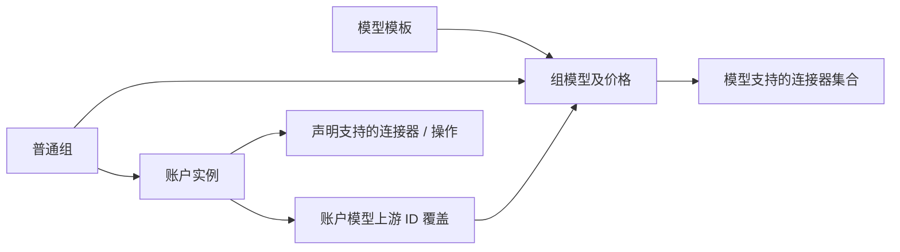

# 分组模型目录与多连接器账户重构设计

## 基本信息

- 规范命名空间：`GROUP-CONNECTOR`；revision：`r4`；更新：2026-11-13。
- 状态：**多连接器账户评估稿，未实施**。已确认的方向与本稿建议分别标注于 §2，其余待裁决和待验证事项见 §11；本文尚不替代现行实现与权威文档，不构成实施、迁移或生产操作授权。
- 关联评估计划：[分组模型目录与单协议连接器重构评估](../plans/计划-20261113T050841000Z-分组模型目录与单协议连接器重构评估.md)。本 revision 和验收集须由计划冻结，测试和复审结果写入计划或报告。
- 当前依据：[供应商与上游协议面重构设计](供应商与上游协议面重构设计.md)、[自定义模型与模型映射设计](自定义模型与模型映射设计.md)、[策略路由设计](策略路由设计.md)、[普通分组可选调度策略设计](普通分组可选调度策略设计.md)、[系统团队与统一授权设计](系统团队与统一授权设计.md)、[超级分组设计](超级分组设计.md)、[音频视频模型接入与统一媒体网关设计](音频视频模型接入与统一媒体网关设计.md)。
- 生效基线：未生效。`MUST` 表示目标方案接受并实施后的约束，不表示已经实现或测试通过；实施前须完成引用文档同步、迁移设计与所需授权。

## 1. 背景、目标和范围

现行设计以真实厂商、连接器及可配置协议能力共同约束账户，并存在独立模型目录和账户模型映射；普通分组、路由、调度和授权各有语义。现行模板选择已有部分字段复制，模型表单不复制目标模型 ID（`frontend/src/views/providers/customProviderModelForm.ts`、`CustomModelFormModal.vue`），后端读取可见 active 模型填充目标（`backend-go/projects/gateway/internal/providers/write_routes.go`）。分组当前页面提供编辑、成员和删除，组克隆为新能力（`frontend/src/views/groups/groupRowActions.ts`）。

现有文档和前端限制普通用户编辑价格，但 Go session API 静态写入链按 owner 校验并接受价格字段，存在需核验的不一致；本轮未运行 HTTP 验证，不断言后端已禁止私人模型价格修改。现有账户单连接不意味着多 Key 调度或 API Key 池应删除。官方默认组现按 owner 建立；其新账户池语义见 §2。

目标是保留 `API Key → 路由策略 → 普通分组 → AI 账户` 层级，把组作为号池、模型和价目表；模型归属一个规格 / 计价结构模板，账户使用一套上游连接与认证身份，可声明多个兼容连接器。固定九家厂商不再驱动账户和 adapter。调用、权限、模型目标、计价和历史必须全链可追溯。

本轮仅修订方案：不实现代码、schema、数据变更或发布，不授权清库或生产操作；不提供用户自定义跨协议 bridge / `generic_http` 或任意 HTTP 脚本；保留内建媒体协议适配，不以模板证明上游真实可用，不编造外部价格或性能 SLO。

## 2. 用户已确认的方向

| 原待议范围 | 用户已确认的方向 |
| --- | --- |
| Q1 分组归属 | 每个 AI 账户恰好归一个普通组；普通组是账户池、模型和价目表。官方默认组允许 owner 管理自己的账户，官方目录和模型只由管理员维护。组可被多个路由 / Key 复用。 |
| 模板 / 模型 | 模板定义模型规格和计价结构，是模型的上级；每个模型恰好选择一个模板后才呈现相应规格、价格表单。官方模型是模板的一个模型实例，不是模板本身。 |
| 连接器 | 撤销组级连接器清单与账户单连接器限制；同一 BaseURL / 认证身份可支持多协议，也可按协议拆成不同账户。模型绑定一个或多个实现兼容的连接器。 |
| Q4 模型映射 | 同组不同账户可使用不同上游 ID；同一模型的 ID 别名不改变模型计价身份。实际换模型与别名必须区分，目标模型计价待 §11 裁决。 |
| Q2 授权计量 | 授权调用使用授权方模型、价格、规则和额度体系；使用方本地模型 / 价不能覆盖。授权仅覆盖原 grant 的账户，不能借其来源组扩展其他账户。 |
| Q5 限制 | 旧组级限制退役，旧值不迁移、不合并；新单 IP 并发与软阈值由 API Key 重新配置，默认未设置、不施加对应额外限制。保留账户硬并发 / RPM 和成本、速度等调度偏好。 |
| Q6 超级分组 | 超级分组确认退役，旧配置不自动合并或选组；关联路由须显式重配，未重配不得自动选择组。当前无清理或迁移授权。 |

推荐模板由平台提供、管理员维护，复用已实现的规格、固定表单与计价能力，不提供用户可编程 schema、任意脚本或公式。内部结构变更须校验，不要求本轮建立多版本兼容转换引擎。`DS`、`GLM`、`GPT` 等只是模板结构名称，不决定 HTTP 厂商、BaseURL、请求路径或价格。具体模板与连接器的兼容声明及存量映射须通过实现证据确定。

### 简化取舍

| 来源 | 取舍 |
| --- | --- |
| 用户已确认 | 组不配置连接器清单；一个账户可在同一连接和身份上声明多个连接器，单协议也可单独建账户。 |
| 本稿简化建议 | 模板采用平台固定字段集合、表单和计价规则；内部保留必要版本校验，不建立可编程 schema 或多版本转换引擎。 |
| 本稿简化建议 | 同模板实例只复制到未提交表单；替换已有表单内容经明确覆盖确认，不建立逐字段套用工具或来源版本链。 |
| 本稿简化建议 | 保持账户硬限与已识别 grant 来源共计数，不新增同密钥跨账户全局资源识别；沿既有明确批量编辑操作，不扩建通用批量引擎。 |
| 本稿简化建议 | 不强制所有账户填写 BaseURL；连接器声明哪些连接 / 认证字段由用户填写、固定或派生。当前托管 OAuth 已由 type / preset 派生地址，表单不展示 BaseURL（`accounts/oauth_default_connections.go`、`oauthmgmt/store.go`）。 |

本次多连接器修订中，账户创建体验、自动推导和高级项归属是本稿建议；用户确认同连接多协议及单协议可拆账户的方向，另两项待裁决事项见 §11。

以上简化建议用于压缩方案复杂度，不能推断 r2 已实现完整版本链或通用批量引擎，也不冒称用户逐条批准。

当前计价实现仍有需要补齐的差距：`providers.ModelPriceSet`（`backend-go/projects/gateway/internal/providers/catalog.go`）和 maintenance 的 models schema 覆盖 token / cache / tier / 长上下文 / image / audio 等字段；`backend-go/projects/gateway/internal/pricing/billing.go` 的 `billingPolicyForProvider` 仍按 provider 选择规则。运行时 `pricing.PriceSet` 含视频按秒、按次、分辨率与时长等费率，但现有 models 表和 `ModelPriceSet` 未持久化完整视频费率，视频仍使用静态 catalog 费率。模板实体与模板外键当前不存在。目标须把模板绑定到明确受支持的计价规则并持久化完整视频费率，不以表单复制宣称完成；这里没有外部价格验证。

## 3. 对象与全链约束

| 对象 | 职责与关系 |
| --- | --- |
| 普通组 `G` | 归 owner，包含模型、报价和账户；组不配置连接器。官方默认组目录 / 模型由管理员维护，账户归各 owner 管理。 |
| 模板 `T` | 引用平台固定规格字段、价格结构与计价规则；必要结构版本为内部实现细节，不是官方模型实例或厂商驱动器。 |
| 组模型 `M` | 恰好属于一个组、引用一个模板；有稳定内部 ID、公开别名、默认 upstream ID、报价和 ≥ 1 个兼容连接器。 |
| 账户 `A` | 恰好属于一个普通组，对应一套上游连接和认证身份，可声明多个兼容连接器及其模型 / 操作范围；不是多个地址或不同平台身份的容器。 |
| 账户模型映射 | 默认模型 ID 可按账户覆盖；必要时同模型按连接器进一步覆盖。别名不改变计价身份；实际换模型另按 §5.2 处理。 |
| 路由 / 授权 | 路由选择组；授权按原 grant 及授权方的模型、价格、规则与额度执行，不扩大账户范围。 |

自有模型不变量：`M.connectors` 非空，成员与模板计价规则及连接器真实实现兼容。账户声明模型时默认声明其配置的操作 / 接入范围；高级配置可按实际情况收窄连接器范围，例如模型支持 Chat 与 Responses，账户仅声明 Chat。目录能力不证明该账户真实支持，配置完整也不代表已验证。后端所有写面与运行时均校验权限、账户声明及能力，不能仅隐藏 UI。

对每个已声明可调用的 `(account, model, operation)`，保存后的运行绑定必须确定**唯一连接器、认证身份和最终 upstream ID**。模型 + 操作能唯一解析且账户声明支持时自动推导，减少重复选择；多个视频 adapter 对同一模型和入口均可能命中时，在高级接入差异 / 模型接入配置明确一次。歧义显示“需补充”并不可调度，不取首个、不自动探测或试错全部候选。自动推导省去重复表单项，运行绑定事实仍须可读取、可核验。

授权来源模型为只读引用，所选连接器必须属于来源模型并为该单一 grant 账户声明和实际授权范围所支持。仅调用授权不自动授予模型配置读取 / 复制权，本地组不能扩大来源模型或账户范围。

调用链：`API Key → 路由策略 → 普通组 → 模型与价格 → 账户声明 / operation → 唯一连接器 + 认证 + 最终目标 ID → 上游 → usage / 价格快照 / 终态`。授权调用先解析原 grant 及授权方的模型、价格、规则和额度。若实际换模型，必须按 §5.2 解析目标模型；不以名称猜测。是否按实际目标组模型价格计价待用户裁决。

## 4. 连接器与账户

连接器由研发固定实现并声明完整操作族、认证支持、协议编解码、流与非流、媒体流程、错误与 usage；不提供 `endpointModes`、JSON / SSE 或两端协议的自由矩阵。内建视频连接器负责统一对外视频协议与各厂商原生接口双向适配，包括路径、认证、参数、创建 / 查任务 / 结果、状态、错误、响应和 usage 归一；不恢复用户任意协议桥接或通用 HTTP 脚本。

账户对应一套连接地址与认证身份，可使用多个兼容该连接 / 认证的连接器；不同地址或不同平台身份仍分账户，不因此设计任意多连接 schema。API Key / OAuth 认证方式及适用 issuer 必须明确，不能由模型品牌猜测；保留现有已实现 OAuth 接入流程，同一账户不混合互不相关的平台身份。OAuth authorize / token / callback 是认证端点，不计作多个上游连接。可配置 BaseURL 为服务 / 版本根，与操作路径直拼，不自动补、剥或去重版本段，并遵守 URL 安全校验。连接器声明字段由用户填写、固定或派生。

常用创建流程选择组、填写名称和连接 / 认证、选择支持模型；不单独强制选择连接器。模型勾选是对该账户支持配置操作 / 接入范围的声明，可按需在高级项收窄与填写差异，不恢复 JSON / SSE 或 `endpointModes` 矩阵。唯一候选自动推导，歧义才需要明确执行连接器；单协议账户也可自然创建。具体将歧义项放在账户高级项还是模型接入配置待 Q13，不能改变唯一绑定的目标约束。

### 4.1 账户配置归属与界面取舍（建议）

| 项 | 通用框架与专属语义 | 默认 / 高级行为 |
| --- | --- | --- |
| 基本连接 / 认证 | 一账户一连接和身份；各连接器声明认证兼容与所需字段 | 创建时填写必要字段；固定或派生地址不要求用户填写。 |
| 支持模型 / 操作 | 模型目录、账户声明和连接器固定能力共同决定候选；保存绑定唯一 connector / auth / ID | 常用流程选模型自动推导；仅需收窄或消歧时展开高级配置，不把目录当验证。 |
| 模型 ID 映射 | 组模型默认 → 账户通用覆盖 → 连接器专属覆盖；实际换模型另处理 | 默认沿用公开 ID；有差异才填写对应覆盖，不改变组模型计价身份。 |
| 错误策略 | status / code / text 等匹配框架可共用；当前动作主要在 account / selectedKey，不能假设已有 connector 隔离 | 新默认按证据限制失败影响范围；仅证实共享凭据或额度失效才按规则扩大。已有用户明确配置的 account 级 disable / cooldown 不得静默缩小，须逐规则说明并迁移、展示作用范围；创建页不强加 scope 矩阵。 |
| 响应检查 | 现有检查是 Chat 语义帧；媒体 UI 隐藏，不扫描视频二进制 | 默认继承适用系统规则；连接器归一的媒体状态 / 结果可设计领域检查，尚不能声称已有支持。 |
| 请求覆盖 | `reasoning` / `serviceTier` 等按最终 connector / operation / model 适用 | 默认保留客户端字段并沿用现行 reasoning 降级及 default 删除 tier 等契约，变更须显式迁移；不新增全局任意 body 覆盖。 |
| 测试 / 健康 | 按账户已声明、已消歧的连接器 / 操作和代表测试模型分别记录 | 一按钮触发并列出覆盖对象；用户未选或未唯一解析的组合不发请求，不扫描组全部模型或候选 adapter。对话固定流式，安全媒体探针只证明连接，缺探针显示未验证。单项失败不宣称整号 / 全模型不健康，除非共享身份硬失败。 |
| 代理 / 限制 / 恢复 / 授权 | 代理 / 池互斥、账户硬并发 / RPM、恢复和 grant 来源是既有账户或资源语义 | 默认沿用现行系统规则，按需配置；多连接器不复制扩张额度、不改变授权范围。 |

高级策略默认继承系统；普通创建不必逐项配置。执行记录展示采用或未采用的策略及原因，不将建议的目标隔离冒充现有行为。媒体任务一经受理冻结选定连接器、Key 及上下文，不跨连接器或账户重放。Realtime 的连接器、会话、usage 和迁移仍须验证，不宣称已兼容。

## 5. 模板、模型与报价

### 5.1 模板与填值

模板使用平台固定字段、表单及计价规则，复用 typed `ModelPriceSet`、`PriceSet` 和现有 billing policy 能力；结构如下，不是用户可编程 schema：

| 结构 | 内容及用途 |
| --- | --- |
| `template_id` / 内部结构版本 | 模型保存恰好一个模板 ID；必要的内部版本用于变更校验，用户不选择 revision。 |
| 规格字段定义 | 每字段声明类型、是否必填、约束及可选值，涵盖该结构适用的模态、上下文和能力等。 |
| 计价结构 | 明确支持的计量维度、单位、适用条件、费率字段及有效性校验；包含适用的视频完整费率字段。 |
| 固定计价规则 | 模板内部明确选择平台受支持的规则，用户不选择 `billing_rule_id`；不执行任意脚本，也不按品牌推断。 |
| 兼容声明 | 声明模板规则与连接器归一 usage 的兼容条件；实例另选已实现且兼容的连接器集合。 |

实例在模板定义下填具体规格、费率、默认 upstream ID 和连接器集合。只有连接器提供的归一 usage、模板固定规则与模型费率三者匹配且实现支持，才可建立兼容关系；三者仅各自存在并不足以证明兼容。

| 拟议结构示例 | 可表达的内部结构 | 边界 |
| --- | --- | --- |
| DS / GLM 类对话 | 复用现有 token、cache、tier 或长上下文能力中适用的规格与计价字段 | 名称仅说明结构，不绑定对应厂商或路径；具体字段以实现核验为准。 |
| GPT 类对话 / 图像 | 按实际对话 token 或图像计量结构分别建模板，填写各自费率维度 | 一个品牌不必对应一个模板，相同结构可复用。 |
| 视频 | 对应已支持的按次、按秒或分辨率 × 时长等固定规则及完整费率字段 | 模型持久化、usage 匹配与规则实现必须验证；不提供虚构费率。 |

以上只是基于现有内部能力的拟议结构示例，不表示任何厂商现行收费或外部价格。

模型建立必须先选一个 `T`，无模板不能创建模型（含草稿）；选定后才出现规格和价格表单。用户可从空白填写，或从有配置读取权限的其他组 / 官方组同模板模型复制填值到未提交表单；仅调用授权不自动授予配置读取权，跨模板复制禁止。复制后用户检查、修改并保存；若覆盖表单已有内容，先明确确认覆盖。源模型后续更新不自动改变目标，无需记录来源 revision、选中字段或建立独立重新套用工具。模板结构变更保留内部必要校验，不要求多版本兼容转换引擎。

| 字段 | 填值与复核 | 边界 |
| --- | --- | --- |
| 模板 / 实例身份 | 选择唯一模板，可选同模板实例填表 | 不继承源 ID、官方身份或写权限，用户不选 revision。 |
| 规格与能力 | 按模板结构和白名单复制模态、上下文、能力 | 用户核对；填值不证明连接器 / 账户真实支持。 |
| 模型与目标 | 公开别名、默认 upstream ID 可独立填写 | 账户级覆盖单独存储；不根据前缀推断协议或价格。 |
| 报价 | 拷贝完整计价维度、适用条件、单位、币种与数值，标记来源 | 用户复核；更改单位 / 币种不得直接沿用数值。 |
| 官方 `shutdownDate` | 仅作为来源参考并提示核对 | 不自动变成私人实例停用日期。 |
| 账户及运行态 | 不复制凭据、OAuth、账户、授权、任务和历史 | 模型连接器从已实现且适用的连接器中选取并验证兼容。 |

内部 USD 结算口径保持；非 USD 来源需用户提供并确认符合现行结算口径的 USD 价格，不新增运行时多币种费率 / 换汇引擎。报价不自动等于供应商账单。未定价草稿可保存但不可调度，显式零价与未定价不同；字段和价格完整时预览后一次确认即可创建并启用，无需多次确认。

表单体验建议：内部 `group_model_id` 由系统生成，用户无需填写。默认 upstream ID 通常沿用公开模型 ID；只有上游名称不同时才填写账户通用覆盖，只有同一账户同一模型的不同连接器确需不同 ID 时才在高级项填写连接器专属覆盖。优先级为 `connector-specific > account > model default`；不要求重复输入相同名称。

### 5.2 账户级目标示例

以下为**虚构示例**，不是外部价格事实：组 A 的模型 `example-chat` 引用模板 T，默认 upstream ID 为 `example-chat`，输入价为 USD 1 / 百万 token；账户 A1 的映射覆盖为 `ep-a1`，A2 覆盖为 `ep-a2`。二者连接器均在该模型的支持集合中。路由命中 A1 发 `ep-a1`，命中 A2 发 `ep-a2`，均按组 A 的同一模型报价及历史快照计价；不得以 `ep-*` 或名称前缀寻找另一模型 / 价格。组 B 可有相同公开名的独立模型和不同报价；实际选中组 B 时使用 B 的模型、目标及报价，不能合并身份。

**ID 别名与实际换模型：**上述覆盖只改变同一实际模型的上游 ID，不改变组模型身份及价格。现行 [自定义模型与模型映射设计](自定义模型与模型映射设计.md) §2 / §3 还支持真实模型 A → B 替换（例如 `gpt-5.5` → `gpt-5.5-pro`），并按实际 target 目录价格处理。r4 不把此能力默默退役：若配置真正换模型，最终能力、连接器、授权和价格必须明确解析目标模型。推荐沿现行按实际目标组模型报价，但这属于待裁决建议（Q12），不是已批准规则；不得把目标 ID 自动当成实际模型替换。

### 5.3 用户流程

| 场景 | 操作和结果 |
| --- | --- |
| 创建私人组 | 输入名称等基本信息创建空组；初始模型、账户和路由数为 0，不配置组连接器。 |
| 创建组模型 | 选择模板，从空白填写或选择有配置读取权的同模板实例填值；核对字段、价格与模型连接器后提交。 |
| 已有组新增模型 | 先选模板再填值，选择已实现且兼容的模型连接器；每个模型获得独立 ID。冲突明确报错，不覆盖或静默改名。 |
| 创建账户 | 填写名称、连接 / 认证并选择支持模型；唯一的连接器 / 操作自动推导，有歧义时高级项明确，必要时填写账户或连接器专属 ID 覆盖。 |
| 克隆组 | 有权限者预览并确认：复制可见模型实例及价格、模型的连接器集合与模板引用；产生新组和新模型 ID。 |

组内模型按类别、状态、关键词筛选，提供价格 / 默认 upstream ID 编辑、复制、启停和删除及引用提示；既有明确的批量编辑操作在提交前确认变更，任一权限、冲突或校验失败整批零写入，不扩建通用批量引擎。组内公开别名唯一、跨组可重复是本稿建议；选中组决定身份与价格，最终命名和冲突规则按 Q8 取证确认。

广场按组展示模型，组详情模型页签与广场共用同一份模型 / 报价 / 状态事实。可筛选草稿、已配置、可调用，并展示查看者有权使用且连接器匹配的可达账户数；未接入模型可展示但标记不可调用。可调用要求有效启用、已定价的组模型与可达且授权账户支持集合相交，并满足请求协议和运行时资源限制。

克隆 `N` 个模型生成 `N` 个独立新模型 ID；初始账户数和路由绑定数均为 `0`。不复制账户、凭据、OAuth、账户映射、授权、Key / 路由绑定、默认官方身份、任务、历史或运行态。只获使用授权不自动获得 clone / export 权；适用的批量编辑或克隆事务失败全部回滚，来源不变。

## 6. 权限和生命周期

| 主体 | 官方默认组 | 自己私人组 | 他人授权资源 |
| --- | --- | --- | --- |
| 管理员（具有对应权限） | 维护模板目录与官方模型；受引用保护 | 按明确管理权限 | 按明确管理权限 |
| 普通 owner | 维护自己账户及账户模型覆盖；不能增改删官方组元数据、目录或模型 | 创建和维护组、模型、价格和账户，受引用保护 | 只在 grant 内使用，不得改源、读取凭据或借源组使用其他账户 |
| 非 owner 无授权 | 按官方可见性读取 | 不可访问他人私人资源 | 不可使用或写入 |
| 非 owner 仅使用授权 | 按官方可见性读取 | 维护自己的私人资源 | 仅使用所授资源，默认不可修改、克隆或导出 |

模板由平台提供 / 管理员维护是本稿建议。后端所有写入包括价格、批量、克隆和导入必须核验所有权与授权，隐藏按钮不构成授权。授权调用始终按授权方模型、价格、规则和额度执行；使用方本地价格不能改变来源扣额或扩大账户范围，历史记录应保留授权来源与使用关系。授权存储结构、记账证据和撤权后任务处理需按现有实现取证，不预设整组授权。

现有账户 grant 创建使用方实例并将其放入使用方本地组；来源账户仍在来源组。`group_accounts.account_authorization_id` 指向单账户 grant，失效不回退到组授权（`backend-go/projects/gateway/cmd/juhe-ai-gateway/chain_accounts.go`）；模型读取按来源账户归属，价格目录优先来源 owner（`chain_usage.go`）。目标保留这种账户级范围和实例调度归组：模型以来源只读引用呈现，授权实例最终选定连接器须匹配来源模型、账户声明及操作且不超出单账户 grant，执行时锁定来源组、模型、模板和价格引用。调用用量归属及 API Key 额度仍属调用方，取价依据是来源体系，来源 grant 额度按来源规则处理；不创建双价格账本、不转为组 grant，也不暴露来源组其他账户。具体锁定及历史快照方式仍需验证。

模板结构改动前必须检查引用与内部变更兼容性，不能静默改变模型字段或计价规则。删除 / 移组 / 改名先检查路由、Key、授权、模型、探针及任务，破坏性未解决冲突阻止提交并列出对象，不默认增加软删除兜底。

停用、下线和撤权应允许立即停止新请求，不以在途任务或引用为由阻止必要操作；保留在途上下文和历史。安全撤销凭据必须允许，无法继续的任务明确失败，不自动换号重放。已受理异步任务冻结账户、连接器版本、selected Key、连接身份、目标、模型和价格；配置变化不得切换目标。变更组 / 连接或删除任务所用 Key 须阻断至终态，除非证明快照完整且不损害回查；同身份 OAuth 正常 refresh 不视作换身份。

当前媒体回查仍读取账户连接选择 / preset / BaseURL（`backend-go/projects/gateway/cmd/juhe-ai-gateway/chain_media_video.go`），任务快照主要覆盖请求与计价（`backend-go/projects/gateway/internal/gatewaymedia/jobsrepo.go`）；这是待验证差距线索，不能单凭此断言现行 bug 或目标已满足。历史 usage、价格、单位、币种和来源快照不得因改价、改名、改组或模板 / 模型更新而重算。

## 7. 调度、并发、授权与退役

- 单 IP 并发和软阈值是 API Key 独立配置，默认未设置时不施加对应额外限制；不从旧组继承、迁移、合并或取 min / max / 首值。旧组级限制退役。调度偏好继续承载成本、速度等，软阈值不放共享偏好。
- 已设置单 IP 并发时，按 `(owner, API Key, IP)` 覆盖该 Key 的全部路由；一次请求跨组重试占 `1` 槽，成功、错误、取消、超时终局释放后占 `0`。可信 IP 获取沿用现有安全边界。
- 现行 `defaultSoftConcurrency` 是账户全局并发达阈值后的软让位，不是排队；新 Key 软阈值延续该软让位语义。账户硬并发和 RPM 照常生效，已识别的 grant 来源实例共计数；独立创建的同 Key 账户本轮不新增全局识别、去重或资源实体。
- 超级分组和旧组级软阈值 / 单 IP 限制及其对应入口确认退役；旧值不迁移、不合并。账户 grant 和来源计价继续保留。超级组的路由引用须由有权者显式重配为普通组；未配置时不可自动选组或猜测等价账户池。盘点、备份、版本切换与回滚必须另行设计和授权，本轮不清理现有数据。
- 自有调用建议组报价作为平台统计和 API Key 额度使用的配置价格，不自动等于供应商账单；授权调用按授权方的模型、价格、规则和额度体系计量，使用方本地改价不能降低来源扣额。具体持久化与快照链路应取证，不新增另一套计价体系。

## 8. 全链兼容与迁移边界

| 链路 | 目标 / 实施前核查 |
| --- | --- |
| 管理 / 公开写 API | 创建、更新、导入、批量、克隆及权限均校验模板、账户声明与模型 / 操作的唯一运行绑定；不能仅删表单 selector。 |
| 模型列表 / 路由 | 组模型、账户映射和交集关系一致；核对 `/v1/models` 现行账户并集契约，模型广场可显示未接入项。 |
| 协议 / 媒体 | 固定操作、流 / 非流、取消、usage、重试逐连接器验证；共用错误匹配框架但补齐作用域，现有 Chat 响应检查不外推媒体；内建视频协议双向适配。 |
| Realtime / OAuth / 探针 | Realtime 仍是缺口；逐连接器核验认证端点、刷新、代理、无副作用探针和 usage，避免泄露凭据。 |
| 授权 / 计价 / 任务 | 以原 grant 为账户边界，核对授权方模型、价格、规则、额度、usage 和历史快照；在途媒体目标与撤权情形需验证。 |
| 存量 / 超级组 | 清点多连接、多组、模型、映射、模板、授权、历史及超级组引用；禁止自动合并，旧限制不转移，路由由用户显式重配。 |
| 回滚 | 设计备份恢复、版本共存、切换与回滚后新增数据处理；无法无歧义转换时停止并列出冲突，不自动丢弃或改价。 |

需覆盖 gateway、jobs、maintenance、前端、缓存、探针、公开接口和集成调用方；任何实际迁移及生产操作另需授权。

## 9. 稳定验收条件（目标，未实施）

量化值为配置和数据不变量，不是性能承诺；以 API / 持久化快照、请求捕获、事件计数或事务前后对照验证。以下已确认规则及其验收不得误读为测试已通过。

| ID | 级别 | 条件与可观察判定 |
| --- | --- | --- |
| GROUP-CONNECTOR/AC-001 | MUST | 账户使用 `1` 套上游连接和认证身份，可声明 ≥ `1` 个兼容连接器；不同地址 / 平台身份不得隐式合并，认证端点不计额外上游连接。 |
| GROUP-CONNECTOR/AC-002 | MUST | 组可包含多种连接器账户，路由仅选符合组 / 模型 / 账户关系、可达且有权限的候选。 |
| GROUP-CONNECTOR/AC-003 | MUST | `endpointModes`、JSON / SSE、检查请求形态、映射两端协议的用户配置项 = `0`；允许高级项收窄账户实际连接器范围并为歧义指定执行连接器。 |
| GROUP-CONNECTOR/AC-004 | MUST | 连接器固定声明操作、认证 / 刷新、协议 / 媒体、错误和 usage，不保留隐藏配置矩阵；内建视频连接器覆盖创建 / 查询 / 结果及双向参数、状态、错误和 usage 适配。 |
| GROUP-CONNECTOR/AC-005 | MUST | BaseURL 与操作路径直拼，版本段自动增删次数 = `0`，非法输入报错。 |
| GROUP-CONNECTOR/AC-006 | MUST | 一键测试分别显示已声明且已消歧的连接器 / 操作及测试模型；对话固定流式，单个结果不能冒充全账户 / 全模型健康。 |
| GROUP-CONNECTOR/AC-007 | MUST | 媒体只使用可证实无生成副作用的探针；无探针显示未验证，连接成功不冒充生成成功。 |
| GROUP-CONNECTOR/AC-008 | MUST | Realtime 连接器、会话、usage 和迁移未完成验证时标记缺口。 |
| GROUP-CONNECTOR/AC-009 | MUST | 普通用户增改删官方目录、模型或官方组元数据成功数 = `0`；owner 可管理自己的官方默认组账户，组连接器配置项数 = `0`。 |
| GROUP-CONNECTOR/AC-010 | MUST | 私人组 / 模型按 owner 或明确授权维护；仅使用授权不能修改、克隆、导出或读取凭据。 |
| GROUP-CONNECTOR/AC-011 | MUST | 每账户实例所属普通组数 = `1`；普通组可由多个路由 / Key 复用。 |
| GROUP-CONNECTOR/AC-012 | MUST | 有配置读取权限的同模板实例可一次复制到未提交表单；源模型后续自动覆盖目标次数 = `0`，仅调用授权不等于配置读取。 |
| GROUP-CONNECTOR/AC-013 | MUST | 模板定义规格与计价结构；每模型模板数 = `1`，无模板模型创建成功数 = `0`，填值不证明上游兼容。 |
| GROUP-CONNECTOR/AC-014 | MUST | 复制将覆盖表单已有内容时先明确确认；取消后表单变化数 = `0`，确认后可编辑并保存，无需逐字段勾选。 |
| GROUP-CONNECTOR/AC-015 | MUST | 报价含维度、适用条件、单位、币种；切换单位 / 币种自动沿用数值次数 = `0`。 |
| GROUP-CONNECTOR/AC-016 | MUST | 未定价草稿可保存但不可调度；显式零价与未定价可区分。 |
| GROUP-CONNECTOR/AC-017 | MUST | 同模型 ID 别名优先级为 `connector-specific > account > model default`，内部 ID 稳定；真实换模型解析目标，定价待 Q12。 |
| GROUP-CONNECTOR/AC-018 | MUST | 建议组内公开别名唯一、跨组可重复；冲突明确返回，规则待 Q8。 |
| GROUP-CONNECTOR/AC-019 | MUST | 克隆 `N` 个模型得到 `N` 个新模型 ID，复制模型连接器集合、模板引用及报价；新组账户和路由数均为 `0`，组连接器设置数 = `0`。 |
| GROUP-CONNECTOR/AC-020 | MUST | 克隆不复制账户、账户映射、凭据、OAuth、授权、路由 / Key、默认身份、运行态、任务或历史。 |
| GROUP-CONNECTOR/AC-021 | MUST | 克隆或既有明确批量编辑任一步权限、冲突或写入失败时目标事务写入数 = `0`，不扩建通用批量引擎。 |
| GROUP-CONNECTOR/AC-022 | MUST | 删除 / 移组 / 改名及修改模板先处理破坏性引用；停用、下线、撤权可立即停止新请求并保留在途上下文。 |
| GROUP-CONNECTOR/AC-023 | MUST | 已受理异步任务冻结账户、连接器、selected Key、身份、目标模型及价格；不得跨连接器或账户重放，安全撤销凭据允许并明确失败。 |
| GROUP-CONNECTOR/AC-024 | MUST | 配置 / 价格变化前后，同一历史记录的价格、单位、币种和来源快照变化数 = `0`。 |
| GROUP-CONNECTOR/AC-025 | MUST | Key 设置单 IP 限制时，跨组重试占槽 = `1`，任一终局释放后 = `0`；未设置时不施加该额外限制。 |
| GROUP-CONNECTOR/AC-026 | MUST | 软阈值由 API Key 单独配置，默认未设置；调度偏好保留成本 / 速度，不承载该阈值。 |
| GROUP-CONNECTOR/AC-027 | MUST | 旧组级限制值迁移或合并数量 = `0`；超级组退役，关联路由须显式重配，未重配自动选组数 = `0`。 |
| GROUP-CONNECTOR/AC-028 | MUST | 账户硬并发和 RPM 照常生效，已识别 grant 来源实例共计数；独立创建同 Key 账户不要求新增全局资源识别 / 去重，授权计量可追溯。 |
| GROUP-CONNECTOR/AC-029 | MUST | 可调用模型须满足有效价格、授权及账户声明的模型 / 操作，并能唯一解析连接器 / 身份 / ID；未接入或歧义项不可调度并可标记展示。 |
| GROUP-CONNECTOR/AC-030 | MUST | 已选模板且同模板来源字段完整，仅需调整价格 / ID 时预览一次即可创建启用；除存在实际接入歧义或差异外，额外必填协议 / 路径字段数 = `0`。 |
| GROUP-CONNECTOR/AC-031 | MUST | 建议同组别名冲突零写入；跨组同名不同价各有独立 ID / 报价，不合并，命名细节待 Q8。 |
| GROUP-CONNECTOR/AC-032 | MUST | 无授权 HTTP 主体分别尝试价格修改、批量和克隆并核对存储，越权成功写入数 = `0`。 |
| GROUP-CONNECTOR/AC-033 | MUST | 新建或克隆组不要求选择连接器，组连接器配置项数 = `0`；账户常用创建流程不单独强制选择连接器。 |
| GROUP-CONNECTOR/AC-034 | MUST | 模型绑定 ≥ `1` 个实现兼容连接器；账户支持范围可收窄，所有写面 / 运行时对声明的模型 / 操作校验权限、能力及唯一连接器 / 认证 / ID。 |
| GROUP-CONNECTOR/AC-035 | MUST | 跨模板或无配置读取权限的实例复制成功数 = `0`；同模板复制到表单后源模型更新不改变目标，无需记录来源 revision。 |
| GROUP-CONNECTOR/AC-036 | MUST | 同组 A1 / A2 对同一模型发送各自账户映射 ID；同账户同模型不同连接器可用专属覆盖，三层优先级正确，别名仍使用同一组模型快照。 |
| GROUP-CONNECTOR/AC-037 | MUST | 授权调用以授权方模型、价格、规则和额度为准；使用方本地改价导致来源扣额下降次数 = `0`，grant 外账户调用成功数 = `0`。 |
| GROUP-CONNECTOR/AC-038 | MUST | 模板结构或模型连接器变更须检查受影响模型、账户与调用引用，破坏性冲突未处理不得静默剥离；组无连接器清单。 |
| GROUP-CONNECTOR/AC-039 | MUST | 模板固定关联受支持的计价规则，用户不选 `billing_rule_id`；连接器 usage、规则和模型费率不兼容的绑定 / 调用成功数 = `0`，支持的视频费率完整持久化。 |
| GROUP-CONNECTOR/AC-040 | MUST | grant 实例归使用方本地组；每次调用选定 connector / operation 和模型均在单账户 grant 范围，来源模型只读且配置受读取权限控制，caller 用量及源价格 / 额度归属不变。 |

| GROUP-CONNECTOR/AC-041 | MUST | 同账户同模型声明 Chat + Responses 时各解析唯一连接器；仅声明 Chat 时 Responses 可调度次数 = `0`，不从目录推断账户支持。 |
| GROUP-CONNECTOR/AC-042 | MUST | 同一模型 / operation 命中多个视频 adapter 时显示需补充且调度次数 = `0`；明确配置后按该连接器执行，自动试错候选次数 = `0`。 |
| GROUP-CONNECTOR/AC-043 | MUST | 新默认按明确规则限制 connector / model 失败范围；未证实共享凭据 / 额度失效时自动封禁全部连接器次数 = `0`；既有明确的 account 级 disable / cooldown 须逐规则展示并显式迁移，不得静默缩小。 |
| GROUP-CONNECTOR/AC-044 | MUST | Chat 检查仅用于适用语义帧；视频二进制扫描次数 = `0`，媒体领域检查未实现时不宣称支持。 |
| GROUP-CONNECTOR/AC-045 | MUST | 高级策略缺省继承系统；请求覆盖只在最终 connector / operation / model 适用时执行，保留现行 reasoning / serviceTier 契约并记录应用原因。 |
| GROUP-CONNECTOR/AC-046 | MUST | 真正 A → B 模型替换显式解析目标能力、连接器、授权和价格；ID 别名不触发换模型，具体目标价规则待 Q12 裁决。 |

## 10. 稳定非功能约束（目标，未实施）

| ID | 级别 | 范围、对照和验证 |
| --- | --- | --- |
| GROUP-CONNECTOR/NFR-001 | MUST | 对无权限主体的同一读写 API，未授权资源 / 敏感字段返回数和成功写入数均 = `0`；以响应和持久化核验。 |
| GROUP-CONNECTOR/NFR-002 | MUST | 同一网关请求对照现行链，因目录、模板或价格新增外部 HTTP 热路径调用数 = `0`；通过调用链记录验证。 |
| GROUP-CONNECTOR/NFR-003 | MUST | 对照外部目录不可用情形，请求按保存的价格快照计价，额外外部计价依赖数 = `0`；用隔离测试验证。 |
| GROUP-CONNECTOR/NFR-004 | MUST | 迁移或批处理失败时目标业务事务部分提交数 = `0`；对照事务前快照，跨系统恢复不冒称数据库原子性。 |

## 11. 仍需解决或验证

多连接器修订的两项产品取舍 Q12 / Q13 尚待裁决，其余为实现前技术验证，不重新询问已有决定。

| 编号 | 待解决问题 | 责任与完成判定 |
| --- | --- | --- |
| Q12 | 实际模型 A → B 替换时是否沿现行按实际目标组模型报价？别名覆盖继续使用原模型价。 | 用户裁决；研发核对现行目标目录计价与授权边界。 |
| Q13 | 同一模型 / 操作无法唯一推导连接器时，最小消歧配置放账户高级项还是模型接入配置？ | 用户裁决；无论入口均须保存唯一绑定，未消歧不可调度。 |
| Q3 | 逐连接器如何验证固定流式测试、媒体安全探针及 Realtime 支持？ | 研发形成逐连接器操作、结果和证据清单。 |
| Q7 | 存量多连接、多组、模型 / 映射 / 模板冲突、在途历史、超级组路由重配和回滚如何执行？ | 研发提出逐条映射、冲突、备份和恢复方案，用户裁决必要操作并授权。 |
| Q8 | 组内名称唯一性、跨组同名及 `/v1/models` 展示的具体冲突规则和兼容迁移如何确定？ | 研发核对现行调用方和索引，用户裁决；不重新质疑账户级 upstream ID 覆盖。 |
| Q9 | 平台固定模板字段 / 规则、视频费率持久化以及连接器 usage 与规则 / 费率兼容如何验证？ | 研发按现有 typed 计价 / 协议能力给清单、必要 schema 补齐及内部变更校验。 |
| Q10 | 授权方计价、额度、grant 账户范围及撤权在途的现有存储和记账链如何映射？ | 研发取证现有实现与场景；不得引入未确认的全组授权或另建计价体系。 |

风险包括迁移误归并导致路由或授权变化、错误引用造成计价变化、连接成功误判生成能力、独立同 Key 账户不跨实例去重的影响以及异步目标变化。实际测试、复审和风险接受以关联计划证据为准。

## 12. 维护与变更记录

影响行为、接口、权限、存储、计价、调度或验收先更新规范；实施前同步现行架构和功能文档，计划冻结 revision / hash 与 AC / NFR 集合。后续修改须记录原因、影响和重新验证范围。

| revision | 内容与语义变更 | 状态 |
| --- | --- | --- |
| r1 | 初版讨论稿，账户归组、授权计价、组限制、超级组、账户级映射为待议。 | 未生效。 |
| r2 | 纳入用户裁决：AC-009/011 官方组账户与唯一归组；AC-012–014/030 模板从官方模型复制改为结构上级、同模板实例填值；AC-017 账户级覆盖；AC-019 组克隆复制连接器和模板引用；AC-022 保护连接器 / 模板引用；AC-025–028 Key 限制重配、旧值及超级组退役、授权方向。保留 AC-001–032，并新增 AC-033–040 验证连接器集合、模板、映射、授权隔离及计价结构。NFR-001–004 保留。 | 历史修订，未实施。 |
| r3 | 用户撤销组级连接器清单；模板 / 硬限等按当时方向收敛。 | 历史修订，未实施。 |
| r4 | 撤销账户单连接器：保留 AC-001–040，修改 AC-001/003/006/017/023/029/030/033/034/036/040 等为一连接多连接器及唯一绑定；新增 AC-041–046 覆盖声明范围、歧义、策略、媒体与实际换模型。NFR-001–004 保留。 | 多连接器账户评估稿，未实施。 |
