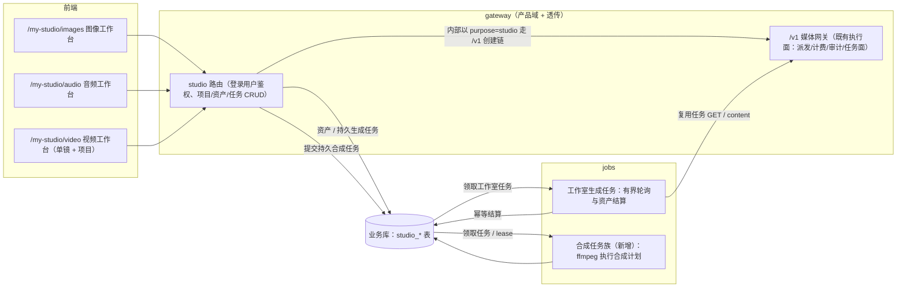

# PLAN-20261012T123000000Z 媒体工作室规划建议

## 基本信息

- 计划 ID：PLAN-20261012T123000000Z
- 创建时间戳（UTC）：20261012T123000000Z
- 状态：P0 已实施（2026-10-13，独立终审中；P1/P2 未开始）
- 创建时间：2026-10-12
- 更新时间：2026-10-13
- 需求来源：用户对话（2026-10-12：图像/视频/音频生成做成"媒体工作室"菜单，视频支持短剧/广告制作，要求前端 UI/流程交互/数据流/业务流/交互流/权限流/布局与测试细节写清楚）
- 执行者：待定
- 关联模块：前端 / 后端（gateway /v1 媒体域 + gateway 产品域 studio 路由 + jobs 生成结算与合成任务族）/ 存储 / 部署（ffmpeg 依赖）

## 需求目标

### 背景

AI 问答内的生图/音视频工具随 [PLAN-20261012T121500000Z AI 问答简化设计](计划-20261012T121500000Z-AI问答简化设计.md) 退场后，媒体生成能力迁往独立"媒体工作室"菜单，三个子菜单：**图像生成、视频生成、音频生成**。视频生成要求支持**短剧、广告等内容制作**——涉及角色、产品、场景、风格等要素资产、分镜、多种素材资源，最终合并成片。

本文记录产品定位、架构依托、三个子菜单、完整前端设计（信息架构、布局、交互流、数据流、业务流、权限流）、开源参考和分期与测试细节。用户已明确保留问答图片识别、将图片/图标生成等媒体生产迁媒体工作室、排除 Sora，并授权代理审核其余选择；本文据此收口方向，P0 已于 2026-10-13 实施（行为契约权威见 [媒体工作室设计](../functions/媒体工作室设计.md)，实施差异已按契约回正并回写该文档），P1/P2 仍为规划。

### 目标

- 登录用户获得独立于 AI 问答的媒体生产入口：图像生成工作台、音频生成工作台、视频生成工作台。
- 视频子菜单分两档：单镜快造（文生视频/图生视频，即开即用）与项目工作台（短剧/广告：剧本 → 要素库 → 分镜 → 逐镜生成 → 配音 → 字幕 → 合成）。
- 全部生成能力复用现有 `/v1` 媒体网关与账户体系；平台不做本地 GPU 推理。
- 前端设计遵循项目既有惯例（无全局 store、路由 meta 体系、三层测试契约），实施时不需要新引入架构。

## 现有基座（源码与历史交付状态，非真实上游可用性保证）

媒体工作室可复用 `/v1` 媒体网关的已实现链路；2026-10-04/05 M0-M7 历史交付记录与当前源码可证，但真实上游联调仍有缺口，不能概括为各模型全部可用。《音频视频模型接入与统一媒体网关设计》是执行面契约，其头部仍写 M3+ 未实施、正文已有多家 adapter 实施注记；该过时状态需在后续执行面文档同步时校正，本轮计划以源码与分项证据为准：

| 能力 | 端点 | 现状 |
| --- | --- | --- |
| 图像生成/编辑 | `POST /v1/images/generations`、`/v1/images/edits` | 已落地；模型含 gpt-image 系、grok-imagine 系、gemini-image 系、glm-image、image-01、qwen-image 等 |
| 同步语音合成（TTS） | `POST /v1/audio/speech` | 已落地；openai 直连 + gemini/minimax/volcengine adapter + glm 透传；响应为纯音频字节，无时间戳结构（已核实 `gatewayresponse/nonstream.go:614-659`） |
| 语音识别（STT） | `POST /v1/audio/transcriptions\|translations` | 路由链已落地；文本/SRT/时间戳及翻译支持按具体模型/adapter 验证，不能推广为所有供应商均支持 |
| 长音频异步任务 | `POST/GET /v1/audio/jobs` | 已落地（qwen paraformer） |
| 视频异步任务 | `POST/GET /v1/videos` + 任务面 | 当前代码注册七家 adapter，含待退役 openai(Sora)；工作室目标保留六家：gemini(Veo)、glm(CogVideoX)、minimax(Hailuo)、volcengine(Seedance)、qwen(万相)、xai(Grok Imagine)。代码存在不等于上游可用，实际型号需能力与联调确认 |
| 实时语音 | `POST /v1/realtime/client_secrets` + `GET /v1/realtime` | 已落地（透传代理） |
| 任务与计费 | `media_jobs` 表、六值状态机、账户亲和任务面、媒体五列用量统计 | 已落地；任务行 7 天 TTL 清理（`media-jobs-retention`） |
| 账户与目录 | `capability_domain` 四域（chat/video/audio/image）、媒体模型目录行、端点模式词表 | PLAN-20261011T141004000Z M1/M2 代码已交付（迁移未在任何库执行） |

**关键边界**：`/v1` API 域执行面实行"零资源存储"（产物不落盘，content 端点纯流式透传），`media_jobs` 任务行 7 天清理。媒体工作室是产品域，作品需可持续回看、下载，因此独立落资产。问答已有异步轮询/幂等结算实现可参考，不能据此推定长期资产与关页后后台结算已经交付；工作室需要自己的任务与生命周期契约。

## 总体架构建议



架构原则建议：

1. **执行面零重复**：工作室不直接连供应商，一切生成经既有 `/v1` 派发循环（账户选择、计费、审计、任务面、受理边界复用）。API Key `purpose` 与请求审计头 `x-juhe-ai-purpose` 分开：当前 Key purpose 只有 `general/chat`，工作室目标新增独立 `studio` 类型及登录用户确保/轮换契约，不能复用问答专用 Key 隐含改变范围。studio Key 的文本（剧本拆解）/图像/音频/视频请求按用户已有授权与域能力裁决；请求头 `studio_text / studio_image / studio_video / studio_audio` 用于审计来源，不作为授权依据。合法枚举、候选模型/端点与审计贯穿测试在 P0 先落权威接口契约，再同批实现，不是当前已存在的能力。
2. **产品域资产落库**：新增 `studio_assets`（产物对象 + 元数据），借鉴用户图片资产的上传、预览与配额边界，独立定义图像/音频/视频生命周期。`chat_assets` 有会话归属与短期引用到期语义，不能直接改名复用其 3 天清理逻辑。工作室作品在配额内持续保留，区别于 `media_jobs` 7 天任务行；用户/项目删除与引用保护、容量回收要同批落契约。任务结算借鉴既有幂等模式，digest 只在同用户授权范围内查重，不能凭同 hash 暴露其他用户资产。
3. **工作室任务与公开任务分开**：公开 `/v1` 保持原有客户端 GET 驱动的任务面，不扫描全部 `media_jobs`。工作室须新增用户/项目归属的 `studio_tasks`，jobs 领取条件为 **"status 未终态 或 结算子状态 ≠ settled"**——覆盖"上游已 completed 但下载/入库失败、进程崩溃"的中间态，避免该类任务永远无人接管（重启恢复用例进 T4）；对领取到的任务做有界轮询与幂等资产结算，前端 GET 展示其状态；用户关页后任务仍完成并及时保存短期上游产物，避免依赖用户在下载 URL 过期前回到页面。图像/TTS 同步产物先落工作室资产再随响应返回（同步端点无独立"保存"开关）。重试遵守受理边界，受理后不重新创建上游任务。**jobs→gateway 通信边界（P0 契约必须定案）**：`studio_tasks` 表 owner 为 gateway（写面），jobs 仅领取/结算；jobs 对上游的查询复用任务面账户亲和直连语义，通信身份（候选：以该用户 purpose=studio Key 经 loopback 调 `/v1` 任务面，不新造服务身份）与故障恢复（lease + 幂等结算）在 P0 权威契约定案，并同步《Go三项目架构基线》相应章节——现基线含历史限定，是否新增 jobs→gateway 调用形态以基线修订为准，不得未经文档先行直接实现。
4. **模型/账户选择**：沿用账户四域与端点模式候选过滤（`images_json` / `audio_speech` / `video_create`），工作室页面只展示当前用户授权范围内对应域的账户与模型目录。
5. **后台合成**：采用业务库持久任务行，由 jobs 领取并续租 lease；不把"表中有任务"当作已有执行队列。P1 契约明确 claim 原子性、超时、取消、有限重试、进度、同任务幂等产物提交及进程崩溃后的接管；临时文件先写后校验再入库，入库失败不得标 completed，回收孤儿产物。合成只读取授权资产的本地快照，子进程参数独立传递，不拼 Shell 命令。

### Sora 退役裁决（用户明确要求）

- 官方已确认 OpenAI Videos API、`sora-2` / `sora-2-pro` 及 `sora-2-2025-10-06`、`sora-2-2025-12-08`、`sora-2-pro-2025-10-06` 于 **2026-09-24** 停用，无推荐替代。来源：[OpenAI API Deprecations](https://developers.openai.com/api/docs/deprecations#2026-03-24-sora-2-video-generation-models-and-videos-api)，2026-10-12 已读取原文。此前"停服传闻"修正为已核实事实。
- 工作室不展示、测试或新建 Sora 任务。后续实施同步退役内置模型目录/种子、计价与能力声明、OpenAI 视频 adapter 注册及专属实现、视频探针/请求信封、示例/Mock/断言和现行功能文档的 Sora 支持说明；不以隐藏菜单或配置开关代替能力退役。
- **本项目 `/v1/videos` 统一 API 保留**，服务其余供应商；OpenAI 的上游 API 停用不等于项目公开接口停用。OpenAI 文本、图片、音频能力保留。
- 历史任务、作品与用量事实保留正常读取，不删除账本、不改写已完成记录；未终态旧任务按既有过期/失败语义收口，不继续调用已经停用的上游或伪装生成成功。实际存量目录与数据处理另在备份后的维护窗口进行，本次不操作真实库。
- 模型生命周期按具体模型核实：已经停用的内置模型不进入候选和探针；仅宣布未来停用、仍可服务的型号不能写成"已不用"。不扩展为本次清理所有供应商模型的任务。

## 子菜单一：图像生成（建议）

定位：最轻的子菜单，作为工作室第一期首个交付，验证产品域架构。

- **交互布局（参考 SD WebUI 三段式 + Fooocus 极简 + ComfyUI 队列/历史双面板）**：
  - 左侧/顶部参数区：模型选择（图像域目录）、提示词、负面提示词（上游支持时）、尺寸/质量等按模型能力载荷动态渲染（复用问答"能力接口驱动表单"的既有模式，不硬编码参数；首版单张，无数量参数）；
  - 图生图/编辑：上传参考图（走 `/v1/images/edits` 形态的账户需支持）；
  - 右侧结果画廊：队列中（进行中任务卡）与历史（已完成作品，按时间分组）双面板；点击回看大图、下载、复制、**查看生成参数**（作品与参数绑定存储，可一键回填表单重生成——参考 SD WebUI PNG Info 的"可回读参数"实践）。
- **范围克制**：首版不做局部重绘/扩图画布、不做提示词扩展引擎、不做 LoRA 类高级概念；只做"文本/参考图 → 图 → 资产库"。
- **依赖**：无新增后端执行能力，纯产品域工作（studio 路由 + 资产表 + 页面）。

## 子菜单二：音频生成（建议）

定位：TTS 配音 + 转写的工具型工作台，同时是视频项目模式的配音底座。

- **功能块**：
  1. **文本转语音**：文本框（长文本按段落拆分）+ 音色选择 + 语速/音量/情感参数（按模型能力载荷）→ `/v1/audio/speech`；结果入资产库可试听/下载。
  2. **音色管理（可选，二期）**：上游支持参考音频克隆的供应商（CosyVoice/fish-speech/GPT-SoVITS/IndexTTS 类托管服务，开源参考见下）提供"参考音频上传 → 试听 → 入库"的音色库；开源实践共识是**音色与情感解耦**（每段配音 = 文本 + 音色 + 情绪 + 语速），建议参数模型按此设计。
  3. **语音转文本**：上传音频 → `/v1/audio/transcriptions`；纯文本为基础输出。SRT 仅在所选 STT 具备分段/字词时间戳或原生 SRT 输出时提供，不能从普通文本虚构时间轴。
- **开源参考**：fish-speech（文本内情绪标记 `<laughing>`/`(angry)` 控制表达，OpenAI 兼容 TTS API 形态）、IndexTTS-2（零样本音色 + 情感参考音频/情感文本解耦）、CosyVoice（instruct 情绪控制 + 流式）、GPT-SoVITS（音色资产 = 参考音频的资产化思路）。
- **依赖**：执行面已落地（M1/M6）；真实上游联调仍待用户提供账户（既有遗留项）。

## 子菜单三：视频生成（建议，重点）

### 模式 A：单镜快造

即开即用的生成页：提示词（文生视频）或首帧图 + 提示词（具备图生视频能力时）→ `POST /v1/videos` → 任务卡轮询 → 成片入资产库。尾帧/多参考图只在目标模型及本项目 adapter 明确支持并验证时出现；可灵等商业参考不等于已接入。参数按模型能力载荷（时长档位、画幅、分辨率）。这是视频子菜单的第一期主体。

### 模式 B：项目工作台（短剧 / 广告制作）

**产品流程参考模型**（综合 AIComicBuilder 七步流水线与 drama-workshop "Script-to-Asset-to-Video" 工作流，开源取证见下节）：

| 步 | 环节 | 平台做什么 | 上游 API 做什么 |
| --- | --- | --- | --- |
| 1 | 剧本导入/创建 | P1 项目创建与剧本文本粘贴/TXT；LLM（走 `/v1` 文本链）拆为场景/镜头，包含对白/动作/情绪/角色/景别运镜；人工可修改。DOCX 解析与多集管理 P2 | LLM 结构化抽取 |
| 2 | 要素库（角色/产品/场景/风格） | 要素 CRUD 与分区；每要素视觉描述；AI 生成或手动上传**参考图**（2-4 张）；要素可多形象（服装/场景变体）；跨项目复用走用户级要素库 + 项目引用 | 图像 API 生成参考图 |
| 3 | 分镜编辑 | 分镜板（卡片流）：每镜 = 对白 + 动作/情绪 + 出场要素（`element_ids`）+ 关键帧占位 + 状态机；AI 生成镜头拆解但**人工可编辑**；镜头可增删排序 | LLM 辅助拆解 |
| 4 | 关键帧 | 每镜首帧图像由 AI 生成或上传替换；要素参考图仅在对应图像模型支持时传入，尾帧作为能力扩展单独验收；风格参考图按模型能力注入 | 图像 API（按能力接受参考图） |
| 5 | 逐镜视频 | P1 基线采用统一首帧 + 镜头提示词；要素参考组、尾帧需先补 adapter / 目录 / 契约与测试，未交付时不显示。异步任务、逐镜重试、状态回填 | 视频 API（按已验证输入/时长能力） |
| 6 | 配音 | 每镜对白 → 音频子菜单同款 TTS（文本 + 音色 + 情绪）；记录每段音频时长供字幕与合成对齐 | TTS API |
| 7 | 音效与 BGM | 音效（SFX）：P2 素材库（按情绪/场景标注），逐镜可挂 0-N 条音效；P1 支持上传有使用权的 BGM 资源并参与混音；音乐生成 API 不进入当前范围 | 无 |
| 8 | 字幕与字卡 | 当前统一 TTS 仅返回音频字节，不提供通用时间戳。P1 **逐镜**用验收通过的指定 STT 对该镜配音音轨生成时间轴（单镜时间基准独立），再人工校正与输出 SRT；镜头重排只影响合成拼接顺序、不使单镜字幕失效；若以后接入 TTS 时间戳，另补契约。对齐失败明确报错，不伪造字幕成功。标题字卡（hook 大字/卖点字）与品牌落版（end card）作为合成计划的文本/图像轨，P1 支持；样式面板 P2 | 支持时间戳的 STT API |
| 9 | 合成成片 | 生成**合成计划 JSON**（镜头片段序列 + 字幕轨 + 配音轨 + BGM/音效轨 + 字卡/落版轨 + 转场 + 画幅）→ jobs 执行 ffmpeg → 成片入资产库 → 页面预览/下载/素材打包 | 无（纯平台能力） |
| 10 | 导出 | 成片下载；二期可选：剪映草稿导出（NarratoAI 实践，交人工精剪） | 无 |

**要素一致性与"角色库"的泛化（本期定案）**：角色只是需要跨镜头一致的要素之一。参照 Pika Scene Ingredients（角色/物体/场景）与 Runway References（角色+风格+场景）的业界共识，平台把一致性资产统一建模为**要素库（element）**，`asset_type` 枚举：`character`（角色）/ `product`（产品与道具）/ `scene`（场景地点）/ `style`（风格参考）。短剧的重心是 `character`，广告的重心是 `product` 与品牌落版——只做角色库无法支撑广告场景。一致性采用三层约束：要素参考资产、模型支持的首帧/尾帧/参考图输入、每镜提示词中的要素描述与资产引用；供应商能力可减少漂移，不能承诺完全一致。首帧、尾帧与多参考图是不同能力，需分别验收。要素 ID 用于站内关联，发给上游的是视觉描述与模型接受的图片输入。StoryDiffusion/ConsistentID 等本地推理方案不进入无 GPU 的平台范围。

**数据模型建议**（参考 drama-workshop schema 与 AIComicBuilder 的 Project/Character/Shot/Task 模型，映射为项目惯例命名）：

```text
studio_projects        项目：id、用户、类型（短剧/广告）、标题、状态、画幅、配置快照
studio_elements        要素（原"角色"泛化）：project_id 可空（空=用户级库）、名称、
                       asset_type（character/product/scene/style）、主角配角/排序、
                       视觉描述、多形象由引用行承载
studio_element_refs    要素参考图：element_id、studio_asset_id、视图类型（正/侧/自定义）、
                       形象标识、revision（参考图变更递增）
studio_shots           分镜：project_id、序号、场景号、对白、动作/情绪、
                       element_ids + element_ref_ids（冻结到具体形象/参考图版本，双列并记）、
                       输入 revision 快照、首帧 asset_id、尾帧 asset_id、视频 asset_id、
                       配音 asset_id、video_task_id、video_status（由任务投影，非独立权威）、
                       生成参数快照
studio_shot_audios     逐镜附加音频：shot_id、studio_asset_id、轨类型（dubbing/sfx/bgm）、排序
studio_text_cards      字卡/落版：project_id 或 shot_id、类型（hook_title/selling_point/end_card）、
                       文本、时长、素材 asset_id 可空
studio_assets          产品域资产（全子菜单共用）：对象存储 key、MIME、时长/尺寸、来源任务号、sha256
studio_tasks           用户/项目归属生成任务：上游 media_job_id、状态（六值词表）、
                       轮询游标/期限、lease、结算 asset_id；镜头/要素图/配音各生成都是一行 task，
                       studio_shots.video_status 等展示字段由 task 终态投影，不在两处独立维护权威
studio_composite_jobs  合成任务：project_id、合成计划 JSON、状态、成片 asset_id、错误
```

P1 还需补独立资源关联（项目/分镜到资产，带 `role`：背景、商品、LOGO、参考图、配音、BGM），广告素材不挤进要素字段。要素跨项目复用时，以用户级要素资产库 + 项目引用建模，不用 `project_id` 独占行同时声称可复用。生成请求参数、要素引用版本（revision）与合成计划快照绑定，编辑不覆盖已完成成片；**任务结算回写镜头时比较输入 revision 与活动任务 ID：要素参考图/镜头参数变更后完成的旧任务结果只进入历史资产，不得把当前镜头标回 `generated`**；修改镜头后标记其帧/视频/配音及依赖成片需重生成，其他镜头不重跑。

- 多集短剧：`studio_projects` 支持 parent/episode 结构或加 `episode_number` 列（对齐 drama-workshop `episodes.merged_video_path` 模式）；首版单"项目=单成片"，多集二期。
- 每镜视频状态机复用 `media_jobs` 六值词表（`queued/in_progress/completed/failed/cancelled/expired`）；镜头卡片状态从 `studio_tasks` 投影，前端轮询的是 studio 任务状态接口（由 jobs 结算驱动），不是 `/v1` 公开任务面。

**合成引擎定案**：由 jobs 任务族运行 **ffmpeg**，用于片段拼接、字幕烧录和 BGM/配音/音效混音。这是新增外部二进制依赖，需同步运行时镜像、字体、gateway/jobs 共享资产路径、部署与回滚文档；Go 编排无需引入 Node/React 或 Python 渲染运行时。合成计划到参数的构造可做纯函数 Mock 测试，实际编码还需用本地短素材验证时长、音画同步与输出可播放性。首版不采用 Remotion / moviepy。

## 前端设计（P0/P1 实施蓝图）

本章按项目既有前端惯例落地（取证基础：无全局 store、`frontend/src/router/index.ts` 路由 meta 体系、`AppLayout.vue` 菜单聚合、`api/domains/` 一域一文件、`types/domain/` 一域一文件、views 按 View + 子组件 + 纯逻辑 ts 拆分、三层测试契约）。原则：**遵循现有模式复制式复用，不引入 Pinia/新状态库/新 UI 库**（`docs/architecture/frontend/README.md` §2"轻量闭环、避免提前引入重型状态"）。

### F1 信息架构与路由

路由落点（`router/index.ts`；用户侧统一 `viewScope: 'self'`，跟随 `/my-*` 前缀惯例）。注意项目路由机制：**`menuRoutes` 数组中的每条路由都会按 `viewScope` 自动渲染为菜单项**（`AppLayout.vue` `visibleMenuRoutes` 无"登记但不显示"开关）；非菜单页面的先例是登记在顶层 `routes` 数组（如 PROFILE_PATH，`router/index.ts:723-732`），经 `...menuRoutes` 展开一并注册：

| 路由 | 期 | 登记位置 | meta 声明 | 页面 |
| --- | --- | --- | --- | --- |
| `/my-studio/images` | P0 | `menuRoutes` | `menuGroup: 'studio'`、`menuGroupTitle: '媒体工作室'`、`title: '图像生成'`、`keepAlive: true`、`heavy: true` | 图像工作台 |
| `/my-studio/audio` | P0 | `menuRoutes` | 同组，`title: '音频生成'` | 音频工作台 |
| `/my-studio/video` | P0 | `menuRoutes` | 同组，`title: '视频生成'` | 视频单镜快造 |
| `/my-studio/video/projects` | P1 | 顶层 `routes`（不进菜单，从视频页入口进入） | `viewScope: 'self'`、`title: '项目工作台'` | 项目列表 |
| `/my-studio/video/projects/:id` | P1 | 顶层 `routes` | 同上，`keepAlive: false`（工作台重，进出重置轮询） | 项目工作台 |

菜单接线（既有三处同步惯例）：

1. `router/index.ts`：P0 三条路由共用 `menuGroup: 'studio'`，分组排序按声明顺序插在用户区期望位置；
2. `AppLayout.vue` 的 `menuIconMap`：为三条路径登记 `@ant-design/icons-vue` 图标（如 PictureOutlined / SoundOutlined / VideoCameraOutlined），`menuGroupIconMap` 登记 `'studio'` 分组图标；
3. 分组子菜单展开由 `openMenuKeys` computed 自动处理，无额外代码。

P1 项目列表/工作台因不在 menuGroup 内，侧栏不会高亮 studio 分组（与 PROFILE_PATH 等非菜单页一致）；走查预期按"从视频页入口进入，面包屑/页头返回"设计，不为此改菜单机制。

权限声明：三条路由均为 `viewScope: 'self'`、不带 `roles`（登录用户可用）；既有 `router.beforeEach` 登录守卫与角色重定向逻辑零改动。

### F2 页面布局与 UI 构成

统一布局语言：列表/工作台页面用 Ant Design Vue 既有组件（a-form/a-select/a-slider/a-upload/a-table/a-tag/a-modal/a-drawer/a-image）。断点双口径（各自有权威）：**列表页 900px**（PC 分页表格 / 手机卡片，`docs/architecture/frontend/响应式列表规范.md`）；**工作台页 992px**（AppLayout `isMobile` 口径，三栏折叠/抽屉化）。列表页复用 `useResponsivePagedList`，F2.1-F2.3 工作台在 992px 以下参数区折叠为顶部/抽屉形态（各节已注明）。

**F2.1 图像工作台 `/my-studio/images`（P0）**

```text
┌──────────────┬──────────────────────────────────────────┐
│ 参数区（左，  │  生成队列（进行中任务卡：骨架缩略图 +       │
│ 360px，移动  │  进度/排队态，失败红态 + 重试）             │
│ 端折叠为顶部 ├──────────────────────────────────────────┤
│ 抽屉）       │  作品画廊（历史，按日期分组网格；           │
│ · 账户/模型  │  a-image 预览；悬浮操作：回填参数/下载/     │
│ · 提示词     │  复制/删除；空态引导文案）                  │
│ · 负面提示词 │                                          │
│ · 尺寸     │                                          │
│ · 参考图上传 │                                          │
│ · 成本预估行 │                                          │
│ [生成]       │                                          │
└──────────────┴──────────────────────────────────────────┘
```

组件拆分（`views/my-studio/studioImages/`）：`StudioImagesView.vue`（容器）、`ImageParamsPanel.vue`（参数表单，能力载荷驱动）、`StudioGalleryPanel.vue`（队列 + 历史双面板）、`studioImageOptions.ts`（列/选项常量）、`studioImageDisplay.ts`（格式化纯函数：日期分组、成本、状态文案与 Tag 色）、`useImageGeneration.ts`（提交与轮询行为组合式函数）。

**F2.2 音频工作台 `/my-studio/audio`（P0）**

页顶 `a-tabs` 两个页签："文本转语音"（左文本区 + 右参数区：音色/语速/情感按能力载荷；底部试听播放器——合成响应返回即已入素材库，无独立保存开关）与"语音转文本"（上传音频 → 结果文本框可复制，支持时间戳时提供 SRT 下载 Tab）。历史合成列表在页签下方（页码/增量分页，条目=播放器+参数摘要+删除）。组件拆分（`views/my-studio/studioAudio/`）：`StudioAudioView.vue`、`TtsPanel.vue`、`TranscribePanel.vue`、`AudioHistoryList.vue`、`studioAudioOptions.ts`、`studioAudioDisplay.ts`。

**F2.3 视频单镜快造 `/my-studio/video`（P0）**

上下结构：上部生成表单（模型/提示词/首帧上传[按能力显示]/时长/画幅，能力载荷驱动）+ 成本预估与生成按钮；下部任务与作品区（进行中任务卡：状态 Tag + 进度条；已完成：内联 `<video controls>` 播放器 + 下载；历史页码/增量分页）。页头右侧提供"项目工作台"入口按钮（P1 显示）。组件拆分（`views/my-studio/studioVideo/`）：`StudioVideoView.vue`、`VideoQuickForm.vue`、`VideoTaskList.vue`、`studioVideoOptions.ts`、`studioVideoDisplay.ts`。

**F2.4 项目列表 `/my-studio/video/projects`（P1）**

`useResponsivePagedList` 双形态列表（PC 表格：标题/类型/画幅/镜头完成度/更新时间/操作；手机卡片）；顶部"新建项目"按钮（Modal：标题、类型短剧/广告、画幅）。组件：`StudioProjectListView.vue`、`StudioProjectTable.vue`、`StudioProjectMobileCard.vue`、`studioProjectOptions.ts`。

**F2.5 项目工作台 `/my-studio/video/projects/:id`（P1）**

```text
┌────────────┬────────────────────────────────┬──────────────┐
│ 要素库面板  │  分镜板（卡片流，拖拽排序）       │ 检查器（右，  │
│ （左，可折  │  ┌─────┐ ┌─────┐ ┌─────┐       │ 320px）      │
│ 叠）        │  │镜头1│ │镜头2│ │ +   │       │ 当前镜头：    │
│ · 分区：角色 │  │缩略 │ │缩略 │ │新增 │       │ · 对白/动作/  │
│   /产品/场景 │  │状态 │ │状态 │ └─────┘       │   情绪编辑    │
│   /风格     │  └─────┘ └─────┘                │ · 出场要素    │
│ · 要素卡：  │  批量操作条：生成帧|生成视频|      │ · 关键帧      │
│   参考图    │  配音|字幕|合成（按阶段触发）      │   (AI/上传)   │
│   网格、    │                                 │ · 视频预览    │
│   AI 生成/  │  底部：合成预览串播条 +           │ · 配音试听    │
│   上传      │  [提交合成]（显示预估与轨清单）    │ · 重试/删除   │
└────────────┴────────────────────────────────┴──────────────┘
```

移动端（<992px）：三栏改为抽屉切换（要素库与检查器进 `a-drawer`，分镜板单列），沿用 chat 会话抽屉互斥模式（`chatConversationDrawer.ts` 先例）。组件拆分（`views/my-studio/studioVideoProject/`）：`StudioProjectWorkspaceView.vue`、`ElementLibraryPanel.vue`、`StoryboardBoard.vue`、`ShotCard.vue`、`ShotInspector.vue`、`CompositePanel.vue`、`ScriptImportModal.vue`（剧本粘贴+AI 拆镜确认）、`BatchActionBar.vue`、`studioProjectState.ts`（镜头状态机投影纯函数）、`studioProjectDisplay.ts`、`useStudioProjectWorkspace.ts`（数据装配组合式函数）。

**通用组件（`views/my-studio/shared/`）**：`StudioAssetPickerModal.vue`（素材库选择器：项目/单镜/字卡插入资产时复用，按 MIME/轨类型过滤）、`StudioTaskCard.vue`（统一任务卡：状态/进度/失败原因/重试）、`StudioCostEstimate.vue`（成本预估行：模型目录价 × 规格，目录未知显式标"无法估算"）。

### F3 交互流（关键用户旅程）

时序约定：**异步生成**（图像、视频、长任务）走"提交即建任务（乐观插入队列卡）→ 服务端受理返回任务号 → 轮询终态 → 结算为资产（画廊/镜头就位）"；**同步生成**（TTS/STT）为普通请求-响应，响应即已保存资产，无轮询无独立保存步骤。失败显示原始脱敏错误 + "重试"。**创建幂等**：所有创建类请求携带用户范围 `client_operation_id`（唯一约束）；同 ID 重复提交返回原任务与原资产（不再次调用上游）；**响应丢失（超时/断网，不知是否已受理）时先按 operation_id 查询确认，确认未受理才允许重发**——"重试=新建任务"仅适用于已明确失败的终态任务，未知受理结果不能盲目重发（防重复付费；资产 digest 查重不防护上游调用本身）。

1. **图像生成**：选账户/模型（打开下拉时按需加载候选，缓存于页面内存）→ 填提示词与参数（能力载荷未声明的项不渲染；**首版单张**，数量参数待任务模型支持有序产物集合后另行裁决）→ 点击生成（按钮 loading，乐观插入队列卡）→ `POST`（携 `client_operation_id`）建任务 → 轮询 → `completed` 队列卡翻转为缩略图落入当日分组；`failed` 红态 + 错误摘要 + 重试。点击作品 → `a-image` 预览 → "回填参数"把该作品参数快照写回左侧表单。
2. **音频 TTS**：填文本与参数 → 合成（同步端点，按钮 loading 期间禁重复提交）→ **响应返回即已入素材库**（无独立保存开关）→ 内联播放器试听 → 历史列表插入条目。长文本按空行分段逐段合成，每段独立播放器，避免超时。
3. **单镜视频**：填表单 → 生成 → 任务卡进入"排队中/生成中"（无百分比进度时显示已耗时）→ 终态内联播放 → 入历史。项目入口按钮在 P1 出现。
4. **项目工作台主流程**：新建项目（Modal）→ 进入工作台（空态引导：粘贴剧本或手动加镜）→ 剧本导入（粘贴文本 → "AI 拆镜"按钮 → **确认弹窗显示将创建 N 镜与每镜摘要**，确认后创建，失败保留原文可重试）→ 分镜板编辑（卡片内联改对白/情绪，检查器改完整字段；拖拽排序防抖提交，失败回滚并提示）→ 要素库建要素与参考图（镜头通过 `element_ref_ids` **冻结到具体形象/参考图版本**，生成请求携带该版本 revision）→ 逐镜生成关键帧（AI 生成需先选要素参考[按模型能力]或直接上传）→ 逐镜生成视频（单镜按钮或批量条；**批量前确认弹窗显示"N 镜 × 时长档位，预估 $X"**）→ 配音（逐镜，音色沿用音频工作台默认）→ 字幕（**逐镜**：对每镜配音音轨跑 STT 生成该镜时间轴 → 时间轴校正列表逐条确认；单镜时间基准独立，镜头重排只影响合成拼接顺序、不使单镜字幕失效）→ 合成预览（分镜板顺序串播 `<video>` 序列）→ 提交合成（合成任务卡）→ 成片页（播放/下载/版本历史）。**任务结果回写护栏**：结算更新镜头时比较输入 revision 与活动任务 ID，要素参考图变更后的旧任务结果只进入历史资产，不得把当前镜头标回 `generated`。
5. **取消语义（分层定义，接口与验收按此实现）**：a) **本地取消**——任务未上游受理：置 `cancelled`，不调上游；b) **上游取消**——已受理：经账户亲和任务面尽力 DELETE 上游任务（上游拒绝不阻塞本地收口）+ 停止轮询；c) **completed 未结算**：仅停止展示层轮询，后台结算照常完成；d) **删除项目**：进行中任务按 a/b 收口并明示"N 个任务将取消"，已完成产物按引用保护评估回收；确认弹窗文案与实际语义一致。迟到成功（取消后上游仍返回产物）按 d) 项目删除语义回收、不复活任务。
6. **中断与恢复**：页面关闭/刷新后重进，任务列表从服务端 GET 恢复并续轮询（前端不持久化任务句柄）；轮询失败指数退避（见 F4），网络恢复自动追上。
7. **错误与空态**：所有列表空态给中文引导文案（"还没有作品，从左侧配置参数生成第一张"）；错误提示统一 `message.error(extractApiErrorMessage(error, '<中文兜底>'))`；任务失败在卡片内展示后端脱敏 `error_message`，不弹全局打断。

### F4 数据流

- **事实源与缓存**：服务端为唯一事实源；页面状态为组件局部 `ref`/组合式函数，**不引入全局 store**（对齐现有惯例）。列表/画廊**沿用 `useResponsivePagedList` 既有页码/增量双形态**（PC 分页表格、手机增量加载，`page/pageSize/hasMore` 语义），端点对齐 `mediaJobs` 先例用 `limit/offset`，不新造游标协议。不做 IndexedDB 本地缓存（chat 的 IndexedDB 服务于 3 天保留期高频消息，工作室是长期画廊，直接分页读取）。
- **keepAlive 生命周期**：三个工作台 `keepAlive: true`，必须实现 `onDeactivated` 暂停轮询与上传计时、`onActivated` 恢复并立即补一轮状态同步（防止后台页面空转请求与陈旧任务卡）；项目工作台 `keepAlive: false` 无此问题。状态 Tag 用色按主题令牌/既有 Tag 用色惯例取值，不复制 `media-jobs.ts` 的预设色值常量。
- **轮询**：新建 `views/my-studio/shared/useStudioTaskPolling.ts`，复制 `chatMediaTaskPolling.ts` 模式（依赖注入 + setTimeout 链）：基础 5s、连续失败指数退避封顶 30s、`document.visibilityState !== 'visible'` 跳过且不计失败、回到可见立即补一轮、inflight Set 去重、**迟到响应按任务归属 ID 校验丢弃**（页面切换后旧响应不污染新页面）、终态字段残缺的快照不落定下轮重试。项目工作台一个轮询实例管理该页全部活动任务（注册表 Map<taskId, callback>），不是每镜一个定时器。
- **上传**：复用 `chat.ts` `uploadAsset` 模式（FormData + `onUploadProgress` 百分比 + `timeout: 0` + AbortSignal）；要素参考图/首帧/BGM 上传统一走 studio 资产上传端点，上传中卡片可取消（AbortController）。
- **API 端点草案**（P0 契约文档定稿，前缀 `/__aisys__/api/my-studio`；一域一文件 `api/domains/studio.ts`，类型 `types/domain/studio.ts`）：

```text
GET    /my-studio/accounts                     账户候选（按域过滤，口径同 /my-chat/accounts 两档范围）
GET    /my-studio/models?domain=images|audio|video   域模型目录（能力载荷）
POST   /my-studio/assets                       上传素材（FormData）
GET    /my-studio/assets?limit=&offset=&mime=&role=   素材库列表（limit/offset，对齐 mediaJobs 先例）
DELETE /my-studio/assets/{id}                  删除（引用保护时 409）
GET    /my-studio/assets/{id}/content          内容（preview/original 变量，ETag 304）
POST   /my-studio/generations/images           图像生成（异步受理返回 task；携 client_operation_id）
POST   /my-studio/generations/speech           TTS（同步返回已保存资产；携 client_operation_id）
POST   /my-studio/generations/transcriptions   STT（同步返回文本/SRT）
POST   /my-studio/generations/videos           单镜视频（异步受理返回 task；携 client_operation_id）
GET    /my-studio/tasks?limit=&offset=&status=&operation_id=   任务列表（活动任务恢复轮询；按 operation_id 查询确认受理结果）
GET    /my-studio/tasks/{id}                   任务快照（轮询端点）
DELETE /my-studio/tasks/{id}                   取消（按 F3.5 分层语义：未受理本地取消 / 已受理尽力上游取消 / 已完成仅停止展示轮询）
# P1 追加：projects / elements / element-refs / shots / shot-audios / text-cards /
#         composite-jobs CRUD 与子动作（拆镜、批量生成、字幕时间轴、合成提交）
```

- **前端↔Go 路由契约**：每个新调用会被 `frontend/scripts/contract/api-contract-check.ts` 自动比对 Go 注册面（前端集合 ⊆ Go 注册面，差集即失败），无需手工登记；豁免才需要 `api-contract-allowlist.json` 注明 reason。

### F5 业务流（状态机）

```text
studio_tasks:      queued → in_progress → completed | failed | cancelled | expired
                   （六值词表同 media_jobs；cancelled/expired 为本地终态；结算子状态
                    pending_settlement → settled，settled 前前端不显示成品）
studio_assets:     uploading → ready →（删除保护：被要素/镜头/字卡/成片引用时 DELETE 返回 409）
studio_shots 视频态: draft → frame_ready → generating → generated | failed
                   六值任务终态到镜头视图态的投影规则：completed→generated；
                   failed→failed；**cancelled/expired→frame_ready**（帧仍在、可重新发起生成，
                   卡片提示"已取消/已过期，可重试"）；视图态为纯函数投影。
studio_shots.video_status 列定位：由任务结算事务写入的投影缓存（权威写入点=结算路径），
                   前端纯函数仅在生成中的乐观窗口本地计算同一规则，两侧规则同源，无双权威。
studio_composite_jobs: queued → running(lease) → completed | failed（版本号递增，历史版本保留）
studio_projects:   无强状态机（列表按 updated_at 排序；删除 = 级联确认 + 引用任务取消）
```

跨状态约束：镜头修改（对白/要素/帧）后，其视频/配音任务结果标记"待重生成"提示且依赖它的合成版本置过期；合成预检规则：**全部镜头视频 `generated`；有配音的镜头字幕须就绪，无对白/无字幕镜头（广告常见）允许直接合成**——条件不满足时提交按钮禁用并说明缺项；配音时长超出镜头时长超过容差时合成预检明确报错（P1 不做自动延长/截断，提示人工调整配音或镜头时长）。

### F6 权限流

| 层 | 机制 | 落点 |
| --- | --- | --- |
| 路由层 | 登录守卫 + `viewScope: 'self'`（无 roles 限制，登录用户可用）；`/media-jobs` 管理面维持 `viewScope: 'admin'` + `roles: managementRoles` 不变 | `router/index.ts` 既有 beforeEach，零改动 |
| 数据层 | 全部 `studio_*` 行带 `system_account_id`，所有查询/写入强制归属过滤；越权读取与不存在同型返回 404（对齐 my-chat 口径，不泄露存在性） | studio repository |
| 资源层 | 账户/模型候选 = 登录用户授权范围（口径同 `/my-chat/accounts`：admin/super_admin 全池，其余用户为自有 + 被授权账户——工作台测试用途需要全状态账户可见） | accounts 域既有逻辑复用 |
| Key 层 | purpose=studio 专用 Key，服务端幂等确保；域授权（text/image/audio/video）正向 + 越权用例进 P0 验收 | chain_chat_keys 先例 |
| 资产层 | digest 查重仅同用户范围；素材内容端点校验归属；跨用户引用/读取全部拒绝 | studio 契约 |

**越权测试矩阵**（P0 必测）：用户 A 读/删用户 B 的项目、资产、任务 → 一律 404；A 用 B 的资产 id 组合成计划 → 拒绝；未授权域（如 Key 无 video 授权）发视频生成 → 明确 403 文案；admin 用个人接口只操作自己的工作室数据。

### F7 前端文件组织与测试落点

```text
frontend/src/
  api/domains/studio.ts (+studio.test.ts)        # 一域一文件
  types/domain/studio.ts                          # 类型 + 中文文案/Tag 色映射（惯例同 media-jobs.ts）
  views/my-studio/
    studioImages/ studioAudio/ studioVideo/       # P0 三工作台（F2.1-F2.3 拆分）
    studioVideoProject/                           # P1 项目工作台（F2.5 拆分）
    shared/                                       # StudioTaskCard/AssetPickerModal/CostEstimate
    useStudioTaskPolling.ts                       # 轮询（复制 chatMediaTaskPolling 模式）
```

测试三层（权威规则 `docs/develop/前端测试分层规则.md`）：

1. **vitest 单测**（`*.test.ts` 与源码同目录）：studio 纯逻辑模块放 `views/my-studio/` 下，有 vitest 用例但按现契约**不计入覆盖率门槛统计**（coverage include 仅 `api/shared/composables/lib/utils/config/directives` 七个逻辑域，先例 `views/chat/chatMediaTaskPolling.test.ts` 同样如此）。若实施时要求 studio 纯函数纳入门槛，必须先把函数落位到 `src/shared`/`src/utils` 或先修订分层规则文档（文档先行），不得默默改 config。T1 所列模块的用例本身照常编写与执行。
2. **tsx 回归脚本**（`frontend/src/scripts/regression/`，package.json 注册 `test:studio-*`）：页面源码锚定断言（禁用态、空态文案、错误兜底、能力载荷缺项不渲染控件、AbortSignal 传播路径）；`useStudioTaskPolling` 的行为回放归 T1 vitest（fake timers），tsx 层只做该模块存在性与依赖注入结构的源码锚定。
3. **路由契约比对**（`test:api-contract`，自动）：新增 http 调用必须先有 Go 注册路由。

## 开源与商业参考汇总

| 项目/产品 | 定位 | 对本项目的可借鉴点 | 备注 |
| --- | --- | --- | --- |
| [AIComicBuilder](https://github.com/LingyiChen-AI/AIComicBuilder) | 漫剧流水线（剧本→角色四视图→分镜→首尾帧→逐镜视频→FFmpeg） | 分阶段生成、角色参考图、人工可编辑、分镜版本与 Task 队列 | 当前仓库 Apache-2.0；Next.js/React/SQLite，仅借流程与交互，不移植单体或依赖 |
| [drama-workshop](https://github.com/jinlei665/drama-workshop) | 短剧/漫剧工作流 | characters/appearances、shots、episodes 的关系，角色形象与逐镜状态 | 当前仓库 MIT；需 PG/S3 等配套，其跨项目角色与状态模型应按本项目重新建模，成熟度未验证 |
| [MoneyPrinterTurbo](https://github.com/harry0703/MoneyPrinterTurbo) | 脚本→素材→TTS→字幕→BGM→合成 | Edge TTS 时间戳与 Whisper 备用的字幕分层、参数预览/试听 | 当前仓库 MIT；特定 Edge TTS 能力不是本项目 TTS 契约；不复制其默认配乐资源 |
| [NarratoAI](https://github.com/linyqh/NarratoAI) | 影视解说+自动剪辑 | 剪映草稿导出作为进阶出口；VLM 理解素材辅助文案 | 解说已有视频，非从零生成 |
| [StoryFlicks](https://github.com/alecm20/story-flicks) | 故事转图文视频 | 最简"配置即生成"闭环，可作模式 A 交互骨架参考 | 纯表单，无分镜 |
| [ShortGPT](https://github.com/RayVentura/ShortGPT) | 视频创作框架 | "视频 = 资产 + 时间线"抽象 | Python 库，非产品 |
| [ComfyUI](https://github.com/comfyanonymous/ComfyUI) | 节点式生成引擎 | 队列/历史双面板、增量重试、简化表单承载工作流的交互 | 只借鉴交互，不移植节点执行系统；许可在真实复用时按仓库 LICENSE 核实 |
| [Fooocus](https://github.com/lllyasviel/Fooocus) / [SD WebUI](https://github.com/AUTOMATIC1111/stable-diffusion-webui) | 极简生图 / 全功能生图台 | 风格预设、默认参数、布局、按日期图库与参数回读 | Fooocus 为 GPL-3.0；SD WebUI 为 AGPL-3.0，均仅作交互参考 |
| CosyVoice / fish-speech / GPT-SoVITS / IndexTTS | 开源 TTS | 音色与情感解耦的参数模型；音色库资产化；文本内情绪标记 | 上游以托管 API 接入，不自建推理 |
| 可灵 / 即梦 Seedance / Runway / Pika / HeyGen | 商业视频产品 | 要素一致性交互（多视角参考图、多镜头模式、Scene Ingredients）、Brand Kit 素材库组织 | 交互参考 |

## 分期路线建议

| 期 | 内容 | 说明 |
| --- | --- | --- |
| P0 工作台地基 | `studio_assets` / `studio_tasks` + 产品域路由、Key 契约、jobs 有界结算 + **图像工作台** / **音频工作台（按能力提供 TTS/STT）** / **视频模式 A 单镜快造**（前端 F1-F4、F6、F7 蓝图） | 复用已实现执行面并补产品域后台任务；逐模型 Mock 回放和获授权上游联调，不承诺全供应商能力齐全 |
| P1 视频项目模式最小闭环 | 要素库（character/product/scene/style 四类）→ 剧本导入 → 分镜板 → 关键帧 → 逐镜生成 → TTS 配音 → 字幕（STT 时间轴）→ 字卡/落版轨 → ffmpeg 合成；支持上传背景/商品/LOGO/BGM 资源，无内置 BGM/音效库及字幕样式面板（前端 F2.4-F2.5 + F5 状态机） | 短剧/广告核心价值；时间戳链验证、jobs 合成任务族 + ffmpeg 部署变更 |
| P2 增强 | BGM/音效素材库、字幕样式面板、音色管理、多集结构、剪映草稿导出、成片版本对比 | 按用户反馈排序 |

依赖关系：P0/P1 均依赖 AI 问答简化（PLAN-20261012T121500000Z）先行收口（避免两处同时改动问答域媒体工具与账户域）；P1 依赖部署镜像加装 ffmpeg（部署文档同批同步）。

## 风险与待核实项

1. **Sora 已停用，当前代码仍有注册与目录残留**：官方原文已核实，按上文退役范围安排实施；当前静态代码与线上可用性必须分开记录。Sora 不进入工作室目标。
2. **各上游视频 API 一致性输入形态差异大**：是否支持参考图、首尾帧、时长/画幅档位各不相同；adapter 层需按能力维度建模并在模型目录声明，不能假设统一接口（现有 `provider_options` 扩展通道可承载）。
3. **音乐生成与素材授权**：音乐生成 API 不进入 P0/P1；P1 支持用户上传 BGM，P2 素材库需记录使用权。无需因此新增音乐供应商。
4. **真实上游联调缺口**：视频/TTS 真实账户联调是媒体网关既有遗留项（xAI 语音契约待官方文档回填、CosyVoice 流式池待定），P0 需一并消化。
5. **成本提示**：视频计价单位与规格档位按当前模型目录与上游实际契约读取；批量生成前展示费用估计及其依据，目录未知明确标为无法估算。无固定 Sora 价格示例，不把统一秒价当所有模型事实。
6. **许可边界**：本项目只借鉴开源数据关系与交互，不直接移植代码。GPL/AGPL 及各项目许可义务需在真实复用前核实；不能概括为"许可证禁止复制"。
7. **字幕与合成依赖**：当前同步 TTS 不保证时间戳；本地 ffmpeg、字体、资源共享路径及重试边界都需立项验证，不能以参数生成器 Mock 通过替代真实编码验收。
8. **前端蓝图与契约文档的先后**：本章路由/端点/组件名是实施蓝图而非已注册事实；P0 权威契约（`docs/functions/媒体工作室设计.md`）落定时若与蓝图有出入，以契约为准并回改本节，不保留两套口径。

## 决策收口与立项约束（2026-10-12）

| # | 问题 | 定案 |
| --- | --- | --- |
| 1 | 产品域 studio_* + /v1 执行面 | 采纳；purpose、新专用 Key 类型与授权边界须先落接口契约，再实现，不当作已有 studio 能力 |
| 2 | 分期与优先级 | P0 图像/音频/单镜视频 → P1 短剧/广告项目 → P2 增强；问答简化先行，Sora 不进入候选 |
| 3 | 视频项目模式首版是否含多集（episodes） | 首版单项目=单成片，多集二期 |
| 4 | BGM 来源 | P1 用户上传并混音，P2 素材库；音乐生成 API 不进入当前范围 |
| 5 | 配音音色管理是否进 P1 | 不进（P1 用 `/v1/audio/speech` 既有音色参数即可）；音色库 P2 |
| 6 | ffmpeg 依赖及部署 | P1 实现时同步部署文档；真正部署需该窗口明确授权，本次不部署 |
| 7 | 长期资产与配额 | 采用每用户容量/个数上限、项目引用保护与显式删除；不随 media_jobs 7 天 TTL 删除作品，不承诺无限容量。具体限值在 P0 契约/容量预算确定，无须再次裁决产品方向 |
| 8 | 一致性资产建模 | "角色库"泛化为要素库（`asset_type`：character/product/scene/style），镜头关联走 `element_ids`；短剧重心在角色、广告重心在产品与落版（用户确认"不止角色"的方向后由代理收口） |
| 9 | 二轮审核收口（2026-10-12） | ①任务领取条件含"未终态或未结算"；②创建类请求携用户范围 `client_operation_id` 幂等，未知受理先查询不重发；③TTS 统一同步返回已保存资产（无保存开关）；④图像首版单张；⑤字幕逐镜 STT 时间基准，合成条件允许无对白/无字幕镜头，配音超时长预检报错；⑥列表沿用 `useResponsivePagedList` 页码/增量（limit/offset）；⑦keepAlive 页停用暂停/激活恢复轮询；⑧镜头冻结要素引用 revision，旧任务结果不入当前镜头；⑨取消按 F3.5 分层语义。均由代理按外部审核意见收口 |

## 关联文档

- 执行面契约：`docs/functions/音频视频模型接入与统一媒体网关设计.md`、`docs/functions/媒体上游协议契约与Mock上游规格.md`、`docs/functions/实时语音Realtime网关设计.md`
- 前置计划：`docs/plans/计划-20261012T121500000Z-AI问答简化设计.md`（问答媒体工具退场）、`docs/plans/计划-20261003T164247971Z-音频视频模型接入与多供应商扩展.md`（媒体网关交付）、`docs/plans/计划-20261011T141004000Z-AI账户能力域拆分.md`（四域账户）
- 前端惯例权威：`docs/architecture/frontend/README.md`、`docs/architecture/frontend/响应式列表规范.md`、`docs/develop/前端测试分层规则.md`
- 两域分界裁决：`docs/functions/问答音视频工具设计.md` §2.1（/v1 域零存储 vs 产品域落库——该文档随问答简化归档，但此裁决对工作室仍有效）

## 执行拆解

（P0 已实施 2026-10-13，独立终审中；P1/P2 未开始：）

- [x] 用户裁决媒体工作室方向与 Sora 排除；其余产品选项由代理审核收口；要素库泛化与前端/测试蓝图深化
- [ ] Sora 专属目录/计价/adapter/探针退役，现行权威文档与 Mock 回归同步；保留统一视频 API 与历史账本
- [x] 立项设计文档（`docs/functions/媒体工作室设计.md`：studio_* schema、API 契约、状态机、权限矩阵、配额、jobs→gateway 通信身份与故障恢复——以本文 F 章/数据模型/决策 #9 为输入，冲突时以契约为准）
- [x] P0 后端：studio 路由 + 资产/任务表 + purpose=studio Key + jobs 有界轮询与幂等结算（领取条件含未结算态；client_operation_id 幂等）
- [x] P0 mockdata：studio 域造数样本与 coverage 断言（按 `docs/architecture/功能开发指导.md` mockdata 扩展要求）
- [ ] 基线同步：《Go三项目架构基线》与 `docs/architecture/功能开发指导.md` 增补 studio 域（jobs→gateway 调用形态本期以 jobs 直连上游任务面实施，与基线的出入登记为待用户裁决项，见契约 §5.2）
- [x] P0 前端：路由/菜单三处接线 → studio.ts API/类型 → 三工作台页面（F2.1-F2.3）→ 轮询/上传共享模块 → 三层测试
- [ ] P1：项目模式后端（projects/elements/shots/tasks/composite）+ 前端工作台（F2.4-F2.5）+ jobs 合成任务族 + ffmpeg 部署同步
- [ ] P2：按裁决增量

## 测试细节（P0/P1 验收矩阵）

> 分层遵循 `docs/develop/前端测试分层规则.md` 与后端 Mock 优先规范；真实上游联调只使用当次获授权的账户。状态列在实施时回填。

### T1 前端单测（vitest，逻辑域纯函数）

| 测试项 | 覆盖 | 预期 |
| --- | --- | --- |
| `studioImageDisplay` | 日期分组、状态文案/Tag 色映射、成本格式化 | 边界（跨日/未知状态）回落中文兜底 |
| `studioProjectState` | 镜头视图态投影（draft/frame_ready/generating/generated/failed） | 与 task 终态+首帧存在性的映射全分支（含 cancelled/expired→frame_ready，见 F5）；不出现非法中间态 |
| `studioCostEstimate` | 目录价 × 规格；缺价/未知档位 | 显式"无法估算"，不编造数字 |
| `studioSrt` | STT 时间轴→SRT 生成、人工校正回写、非法时间轴拒绝 | 不虚构时间轴；SRT 结构断言（序号/时间码格式/换行），ffmpeg 真实可读性由 T5 P1 本地编码验收覆盖 |
| `studioCompositePlan` | 合成计划构造（镜头序列/轨清单/画幅/字卡落版） | 缺项镜头时禁用并报缺项清单；计划 JSON 稳定可快照 |
| `useStudioTaskPolling` | 退避封顶 30s、不可见跳过不计失败、迟到响应按归属丢弃、残缺终态快照不落定 | 回放断言全通过（fake timers） |

### T2 前端回归脚本（tsx，源码锚定；目录 `frontend/src/scripts/regression/`，package.json 注册 `test:studio-*`）

| 测试项 | 方式 | 预期 |
| --- | --- | --- |
| 菜单/路由接线 | 源码断言 `menuRoutes` 三条目 + `menuIconMap`/`menuGroupIconMap` 登记（P0 口径；P1 若 `/projects` 裁决并入子菜单则同步更新断言） | 分组渲染、图标齐全、`viewScope: 'self'`；P1 两条登记在顶层 `routes`（源码锚定其存在与非菜单属性） |
| 能力载荷驱动表单 | 锚定"能力未声明项不渲染"实现点 | 不硬编码参数项 |
| 错误与空态文案 | 锚定 `extractApiErrorMessage` 兜底与空态中文 | 无裸英文/无吞错 |
| 上传取消链路 | 源码锚定 AbortSignal 传播路径（提交后响应丢失、取消后迟到成功的行为回放归 T1/T4） | 取消不产生孤立占位卡与孤儿结算 |

### T3 前后端契约与权限

| 测试项 | 方式 | 预期 |
| --- | --- | --- |
| 路由契约比对 | `test:api-contract` | studio 全部调用命中 Go 注册面，差集为空 |
| 越权矩阵（F6） | 隔离实例双用户 API 测试 | B 的项目/资产/任务对 A 全部 404；跨用户组合成计划拒绝；无授权域 403 文案明确 |
| Key 域授权 | purpose=studio 正向 + 越权 | 文本/图像/音频/视频四域按授权放行/拒绝，审计来源头贯穿 |

### T4 后端 Mock 单测与回放

| 测试项 | 方式 | 预期 |
| --- | --- | --- |
| 任务受理与幂等结算 | Mock /v1 创建/查询/内容端点回放 | 终态唯一性、分条互斥、digest 同用户查重三道闸有效；重复结算不重复计费；同 `client_operation_id` 重复提交返回原任务不再调上游；响应丢失后按 operation_id 查询确认，未知受理不重发 |
| 未结算态重启恢复 | 构造 `completed + pending_settlement`（下载失败/进程崩溃）后重启 worker | 领取条件覆盖"未终态或未结算"，任务被重新领取并完成结算或明确失败，不永久滞留 |
| 取消分层语义 | 未受理/已受理/completed 未结算三态分别取消 + 取消后迟到成功 | 各态收口符合 F3.5；迟到产物按删除语义回收，任务不复活、容量账本一致 |
| jobs 有界轮询 worker | 注入时钟 + Mock 上游状态序列 | 领取/租约/超时/崩溃接管/取消语义正确；关页后任务仍结算 |
| 资产生命周期 | 上传/引用/删除/配额 | 引用保护 409；配额边界拒绝；删除后对象回收、容量回落一致 |
| 合成 worker（P1） | 计划参数纯函数 Mock + 重复领取/lease 超时/取消/重启/入库失败回放 | 入库失败不标 completed；孤儿产物回收 |
| **计费唯一性（真实隔离面）** | **真实隔离 gateway/jobs 进程 + Mock 供应商上游**（同一操作重复提交/崩溃重启/并发结算） | 上游创建次数、studio 资产数量、usage/成本台账记录均唯一——全 Mock /v1 无法证明真实 /v1 内部计费不重复，必须经真实两进程链断言 |

### T5 隔离实例浏览器验收（每期收口门）

- P0 清单：三工作台正/反路径走查（生成→轮询→画廊→回填→删除）；移动端断点走查（列表 900px / 工作台 992px 的折叠与抽屉形态）；上传进度与取消；任务失败重试；刷新后任务恢复轮询；`/media-jobs` 管理面不受影响。
- P1 清单：项目全流程（新建→拆镜→要素→帧→逐镜→配音→字幕→合成→成片）走查；批量生成成本确认弹窗；镜头修改后"待重生成"与合成过期提示；成片版本历史；本地短素材真实 ffmpeg 编码验证（字体、字幕、时长、音画同步、混音、分辨率、可播放性）。

### 未覆盖说明

真实 GPT/Veo/Seedance 等上游全量场景在无获授权凭据时标记不适用并注明补测条件；Sora 退役后的 OpenAI 视频路径以退役验收为准，不进入工作室测试范围。

## 进度记录

| 日期 | 状态 | 记录人 | 进展 / 决策 / 阻塞 |
| --- | --- | --- | --- |
| 2026-10-12 | 草稿 | AI | 基于媒体网关取证与开源/商业产品调研（AIComicBuilder、drama-workshop、MoneyPrinterTurbo 等 20+ 来源）创建规划建议稿；待用户裁决后立项。 |
| 2026-10-12 | 草稿 | AI | 初稿曾完成复审；本轮续审发现执行面状态、字幕时间戳、资产保留与依赖口径需要修正，不能将初稿复审视为全部引用均已核实。本轮正文与续审记录为准。 |
| 2026-10-12 | 待开始 | AI | 根据用户补充排除 Sora，读取官方退役公告确认 2026-09-24 停用；保留统一 /v1/videos。收口分期、单项目成片、资源/BGM、字幕时间戳与 ffmpeg 新依赖边界；本次为规划修订，未实施代码、数据或部署变更。 |
| 2026-10-12 | 待开始 | AI | 本轮独立只读复审（gpt_6_luna_xhigh）核对能力、开源参考与闭环，修正 Key/审计来源、关页后台结算、STT 时间轴和 P0 待办一致性；无产品闭环 blocker。相对链接与空白检查通过，代码/运行验收未执行。 |
| 2026-10-12 | 待开始 | AI | 按用户要求深化：要素库泛化（角色→character/product/scene/style 四类，决策 #8）；新增前端设计章 F1-F7（信息架构/布局/交互流/数据流/业务流/权限流/文件组织，全部对齐前端既有惯例取证：无全局 store、路由 meta 三处接线、chatMediaTaskPolling 轮询模式、三层测试契约）；测试细节扩充为 T1-T5 矩阵；补音效轨/字卡落版进分期。前端架构事实经 glm_5.3_flash_low 取证。未实施代码。 |
| 2026-10-12 | 待开始 | AI | 二轮复审（glm_5.3_high）2 blocker 已修：F1 路由落点改为"P0 三条进 menuRoutes、P1 两条登记顶层 routes（menuRoutes 无隐藏菜单机制，PROFILE_PATH 先例）"并补 detail 页无分组高亮的走查预期；F7 coverage 口径改为"views 纯函数有用例但不计入门槛，纳入门槛须先落位 shared/utils 或修订分层规则（文档先行）"。9 条建议落地：cancelled/expired→frame_ready 投影规则、video_status 列定位为结算事务写入的投影缓存、断点双口径（列表 900/工作台 992）、账户候选补"+被授权"、T2 改源码锚定且目录写全、studioSrt 改结构断言、T2 菜单断言分期口径、T5 断点措辞。无剩余 blocker。 |
| 2026-10-12 | 待开始 | AI | 外部审核（用户侧）提出 3 P1 + 7 P2，经源码复核全部成立并收口：①辅助链/Codex OAuth——OAuth 归一化强制 `stream=true`（`oauthnormalizer.go:169`）而现状图片观察按 JSON 消费（`chain_chat_observation.go:306-321`），属既有缺陷，问答计划 D4 已改为"辅助响应形态按账户 profile、OAuth SSE 有界聚合"并补验收门；②后台领取条件扩为"未终态或未结算"并补重启恢复测试；③创建幂等 `client_operation_id`（未知受理先查询不重发）；④镜头冻结要素引用 revision + 结算回写比较活动任务 ID；⑤取消按四态分层定义；⑥TTS 统一同步返回已保存资产；⑦图像首版单张；⑧字幕逐镜 STT、合成条件允许无对白镜头、配音超时长预检报错；⑨分页沿用页码/增量、keepAlive 暂停恢复、状态色按主题令牌；⑩T4 增真实隔离 gateway/jobs + Mock 上游的计费唯一性断言。执行拆解补 mockdata 扩展与《Go三项目架构基线》同步。仍为文档变更，未实施。 |
| 2026-10-13 | P0 已实施（独立终审中） | AI | P0 交付：契约文档《媒体工作室设计》落定并随实施回写差异（取消 c 态 409 `studio_task_already_completed`、403 `studio_domain_not_authorized`、取消同事务 settlement='settled'、生成端点 Key 同步确保、jobs 直连上游形态、受理未知统一 `studio_acceptance_unknown`、capabilities 空对象边界）；schema 四表（`studio_assets`/`studio_tasks`/`studio_operations`/`studio_user_asset_usage`）+ purpose=studio Key 落 maintenance；gateway `internal/studio` 13 端点 + `/v1` 进程内受理链 + Key 域授权校验；jobs `internal/studiosettle` 结算 worker（直连上游任务面、三道闸幂等结算、租约与崩溃恢复）；前端 `/my-studio` 三工作台（images/audio/video）+ studio.ts API/类型 + `useStudioTaskPolling` + `studio-workbench-regression.ts`；mockdata `domain_studio_sample.go`（Key 1、资产 4、任务 9、收据 2、账本 1、coverage 三断言）。验证：gateway `internal/studio`、jobs `studiosettle`、maintenance mockdata Studio 定向测试通过；前端 `test:api-contract` 452 端点全命中 Go 注册面。遗留：jobs→gateway 通信形态与《Go三项目架构基线》出入待用户裁决（契约 §5.2）；隔离实例浏览器验收与文档终审进行中。 |
